# Homelab Hub

A self-hosted control panel for a small homelab, plus a companion **Docs** app: a dashboard with live status, a validated YAML
config you edit in the browser, confirmed and audited power actions (Wake-on-LAN, Proxmox), a shared-expenses page, a browser
terminal, a Docker manager, and a Confluence-style knowledge base whose pages (including interactive web apps) can be published
to the internet one hostname at a time. Java 17 / Spring Boot, SQLite, React; it runs on a Raspberry Pi 4 and a small Proxmox LXC.

> **Status.** This is a personal project built for one homelab (a Raspberry Pi 4 plus a Proxmox host) and published as a reference
> and a starting point. It is tested (see [Build and test](#build-and-test)) but opinionated: expect to adapt `dashboard.yaml`,
> the compose files and the host assumptions to your setup. Nothing in the repository contains real credentials; every secret
> is read from `secrets.env`, environment variables or a `deploy/.env` you create (examples only are committed). Read the
> [Security](#security) section and the "must do" hardening list before exposing anything.
>
> Design notes and the history of how it was built are in [`docs/plan.md`](docs/plan.md) and [`docs/design-history/`](docs/design-history/).

It started by replacing three separate things with a single, tested codebase:

| Before | Now |
|---|---|
| **homepage** (gethomepage): a services dashboard | a dashboard with live status, host widgets and a **YAML config you edit in the browser** |
| **wol-server** (Spring Boot): Wake-on-LAN and Proxmox power endpoints | the same endpoints, plus **confirmed, audited power actions** in the UI |
| a **portfolio** (Next.js + FastAPI + Postgres, three services) | a single-page portfolio with a skill filter, **edited in the Docs app** and published read-only to the public internet from the Docs LXC |

The hub is **one container on the Pi**, `hub-internal` (LAN and Tailscale only: dashboard, actions, config, budget, terminal, Docker), and
serves nothing public. The **Docs LXC** runs `docs-internal` (the Docs editor and the portfolio editor) and two public, read-only containers:
`docs-public` (Docs pages) and `hub-public` (the portfolio). The Pi and the LXC never call each other; see [Docs app](#docs-app).

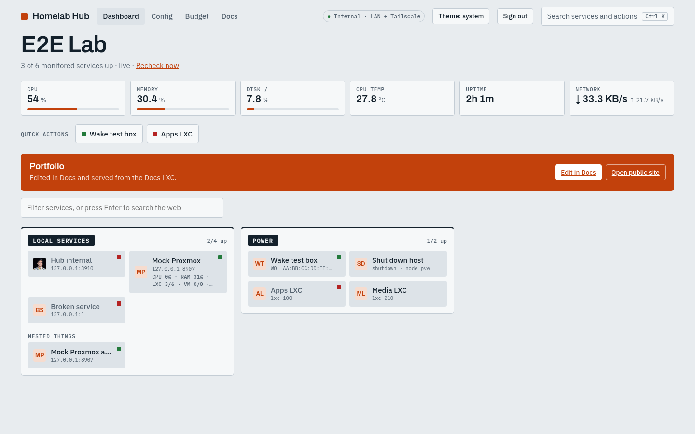

<table>
<tr>
<td width="50%">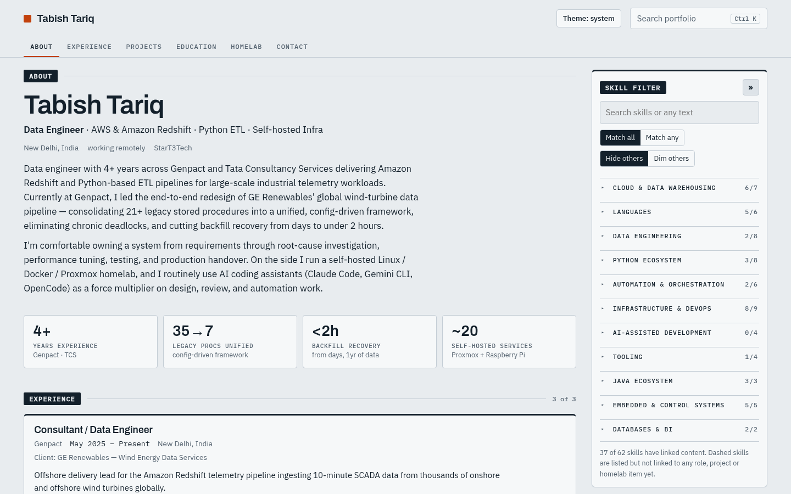<br><sub>Public portfolio (one page, sections + skill filter)</sub></td>
<td width="50%">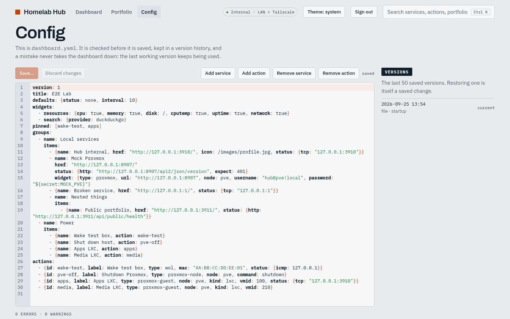<br><sub>Config editor: validated YAML, diff before save, version history</sub></td>
</tr>
<tr>
<td>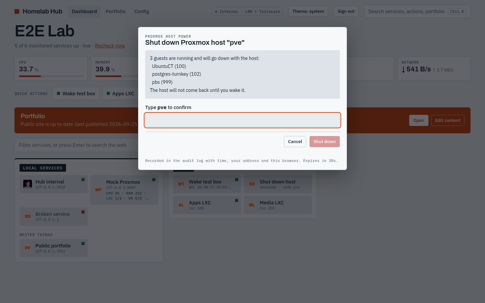<br><sub>Destructive actions need a typed confirmation</sub></td>
<td>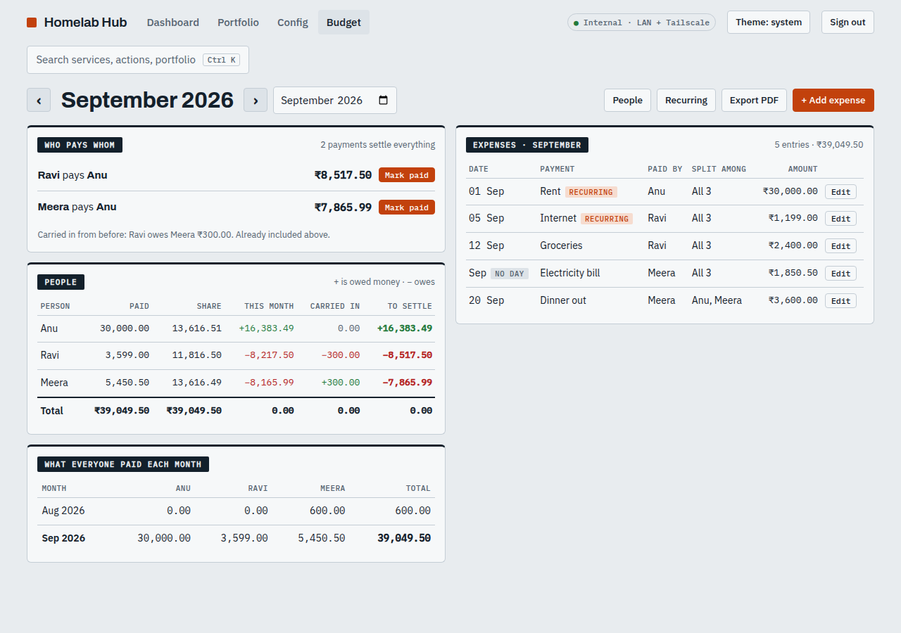<br><sub>Budget: who pays whom, balances carried over (sample data)</sub></td>
</tr>
<tr>
<td>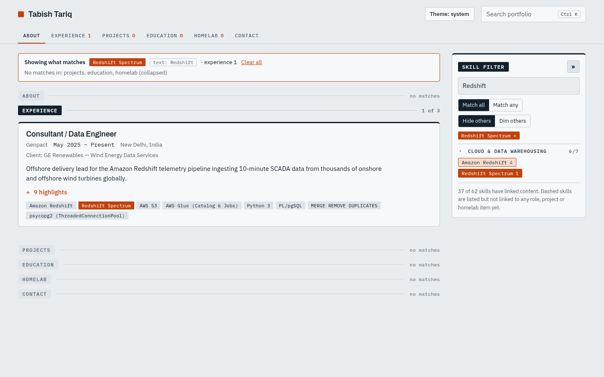<br><sub>Skill filter narrowing the whole page (here: Redshift)</sub></td>
<td>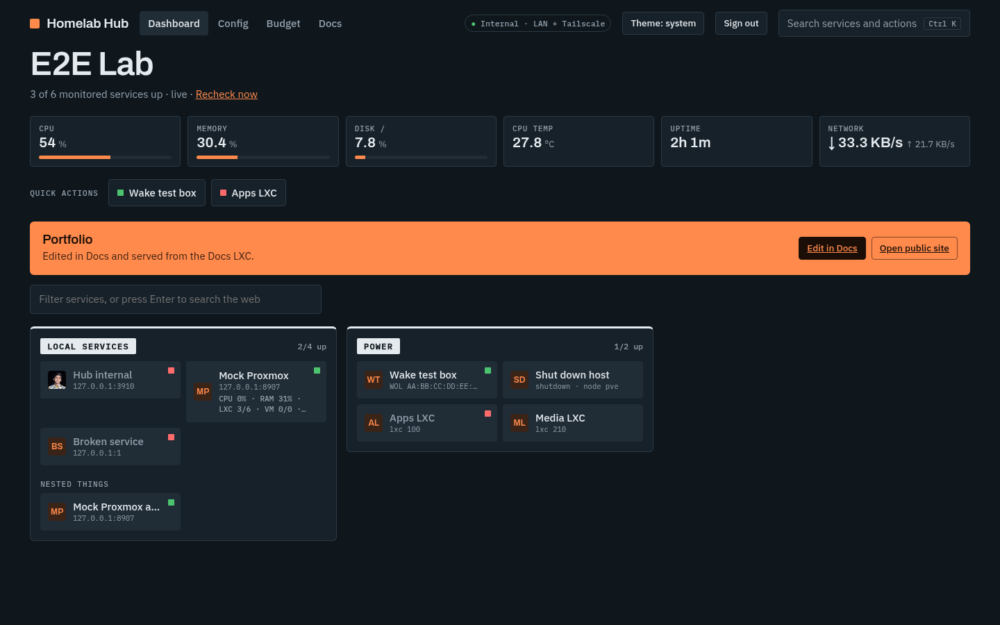<br><sub>Dark theme</sub></td>
</tr>
<tr>
<td colspan="2">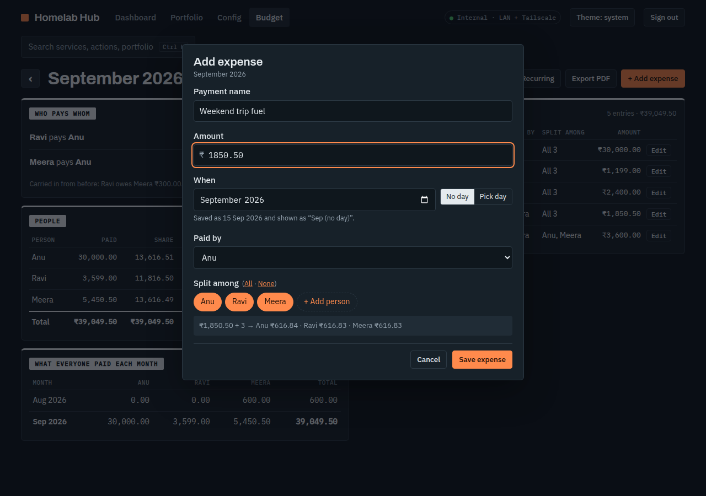<br><sub>Budget: add an expense, month required and day optional, exact split preview</sub></td>
</tr>
</table>

## Contents
[Features](#features) · [Architecture](#architecture) · [Design decisions](#design-decisions) · [Data model](#data-model) ·
[Configuration](#configuration) · [Security](#security) · [API](#api-overview) · [Repository layout](#repository-layout) ·
[Build and test](#build-and-test) · [Deploy](#deploy) · [Operations](#operations) · [Measured on a Pi 4](#measured-on-a-raspberry-pi-4) ·
[Tools](#tools) · [Docs app](#docs-app) · [Known limitations](#known-limitations-and-what-is-not-verified)

---

## Features

**Dashboard** (`hub-internal`)
- Groups of service tiles (nested groups allowed) with live up/down status (TCP, HTTP, or ICMP ping), pushed to the browser over Server-Sent Events.
- Widgets: host resources (CPU, memory, disk, temperature, uptime, network), Proxmox VE, Proxmox Backup Server, File Browser, qBittorrent.
- Quick actions and a `Ctrl+K` command palette across services, actions and pages. Light and dark themes.
- Tiles have fixed, consistent sizes (plain tile / widget tile), one-line names, and adapt to the screen width.

**Power actions**
- Wake-on-LAN (magic packet), Proxmox host shutdown and reboot, Proxmox LXC/VM start and stop.
- Every action is a two-step flow: *prepare* shows what will happen, *confirm* executes it. Destructive ones need the target's name typed.
- Proxmox tasks are followed to the end (the UI shows the real result, not just "sent"). Every attempt is written to an audit log.
- The **legacy wol-server URLs** (`/wake/...`, `/toggle/...`, `/node/...`) still work with the same response shapes, so other tools that call them keep working.

**Config editor**
- `dashboard.yaml` is edited in the browser (CodeMirror), validated on the server with line-numbered messages, shown as a diff before saving, and kept in a 50-version history with restore.
- **Add / remove service** and **add / remove action** forms edit the text in place: comments and layout of the rest of the file are preserved.
- Edits made over SSH are picked up too, and a broken file never takes the dashboard down (the last good version keeps being used).

**Terminal** (off by default)
- A shell on the Pi from the browser, including the installed phone app: xterm.js in the page, and an SSH session from the hub
  to `127.0.0.1:22` as an unprivileged `hubshell` user, relayed over a WebSocket.
- The dashboard password is asked **again every time** a terminal is opened. Idle close after 15 minutes (with a warning a minute
  before), 2 hours at most, 2 sessions at once, signing out closes them. Hosts are declared in `dashboard.yaml`, with the SSH host key pinned.
- Phone key row (Esc, Tab, sticky Ctrl/Alt, arrows, Home/End, PgUp/PgDn, `| ~ / -`), copy/paste, text size, full screen on a phone.
- Only session metadata is audited (who, when, how long, why it ended); typed input and output are never stored.

**Docker** (off by default)
- One page for the containers on the Pi **and any other Docker host** (Proxmox LXCs/VMs, ...): add a host with one entry in
  `dashboard.yaml`. The hub runs the `docker` CLI on each host over SSH (pinned host key, a dedicated `hubdocker` user).
- Per host: containers grouped by compose project, state and health, ports (with an "open" link), live CPU/memory; one host being
  down only shows an error for that host.
- Start, stop, restart, remove, and **Update** (pull + recreate) for compose containers. Every change is two-step with the exact
  command shown first; stop/remove need the name typed. The hub's own containers (and any listed under `protect:`) cannot be stopped.
- Logs: last 200/1000/5000 lines, live follow, search with highlight, wrap, timestamps, copy.
- **Create containers** two ways: **stacks** (a `compose.yaml` + `.env` edited in the browser, validated by `docker compose` on the
  host before saving, 20-version history, deploy/pull/stop/down/delete), or a quick **run form** (image, ports, volumes, env,
  restart, network) that can also be turned into a stack. Long jobs (pulls, deploys) stream their output.
- Every change is audited (no log or file contents).

**Budget** (shared monthly expenses, Splitwise-style)
- People set up once (add any time, also from inside the expense form; archive instead of delete). Expenses in rupees with
  paise, **month required, day optional** (a month-only entry counts as the 15th and shows as "Sep (no day)"), paid by one
  person and **split equally** among the ticked people; leftover paise go in a fixed order, so shares always add up exactly.
- **Recurring expenses** (rent, bills): monthly, with a start, an optional end month and an optional day. Each month's entry is
  created when that month is opened (no background job), and can then be edited or deleted for that month only.
- Month summary: per person paid, share, this month, carried in, settled, to settle; **who pays whom** (a short list of
  transfers, netted across everyone); unpaid balances **carry over**. **Mark paid** records a payment, including a part payment.
- **PDF export** for this month, any month or any date range, shared from the phone's share sheet (download as a fallback).
- Nothing runs unless the page is open: the page is a separate lazy-loaded chunk, with no polling and no server-side job.

**Portfolio** (moved to the Docs LXC; the hub keeps a card with a link to the editor and to the public site)
- One page: About, Experience, Projects, Education, Homelab, Contact, with a collapsible **skill filter panel** (match all/any, hide/dim, free-text search) that filters the whole page.
- Edited in **Docs → Portfolio** (`#/portfolio`): create/update/delete with validation, skill linking, optimistic locking, and automatic publishing.
- The public site is a **read-only snapshot**: `docs-internal` writes `snapshot.json`, the public container (`hub-public`, on the LXC) only reads it.

**Docs** (a separate app on its own Proxmox LXC; the hub only links to it, see [Docs app](#docs-app))
- A Confluence-like page tree: create, rename, drag and drop to reorder or re-parent, **Move to…** for keyboard and phone, duplicate,
  Trash (30 days), Ctrl+K over page titles.
- WYSIWYG editor (TipTap): headings, lists, checklists, tables, images (upload, paste, drag), code with highlighting, callouts,
  collapsibles, attachments, **Mermaid** diagrams, links to other pages, embedded webapps. Drafts, publish, history with a diff,
  restore into the draft.
- **Webapp pages**: upload an `index.html` or a ZIP; it runs in a sandboxed iframe that cannot see Docs, its cookies or its API.
- Pages are internal until they get a **public hostname** (`page1.domain.com`) and are published: a visitor on that hostname sees
  exactly that one page, read-only, never indexed. Everything else is a plain 404.

## Architecture

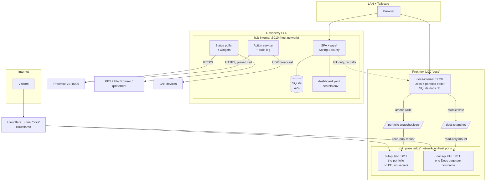

The key property: **the public containers physically lack the dangerous capabilities.** `hub-public` has no Proxmox token, no database file,
no config with credentials and no admin routes. It only ever sees a sanitised JSON snapshot. The hub on the Pi serves nothing public at all. The build enforces this: the
Maven enforcer rule fails if `hub-public` pulls in JDBC, SQLite, Flyway or Spring Security, and a script fails the build if
the public JavaScript bundle contains any admin or dashboard code.

### Modules

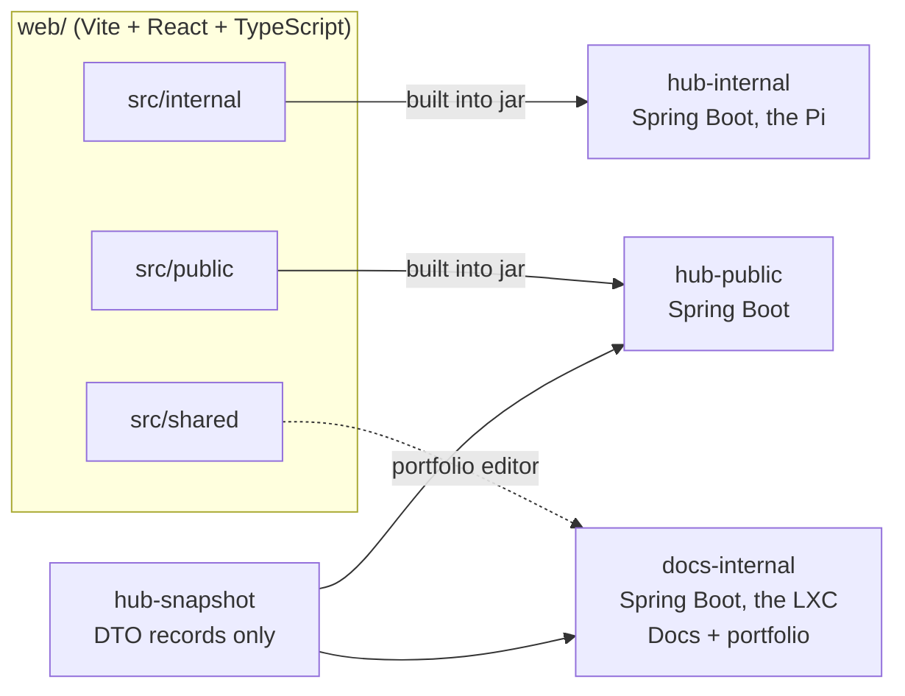

`hub-internal` packages: `auth`, `legacy`, `wol`, `proxmox`, `config`, `status`, `dashboard`, `widgets`, `actions`,
`budget`, `terminal`, `docker`, `backup`, `audit`. The `portfolio` package moved to `docs-internal` (`com.homelabhub.docs.portfolio`).

### A confirmed power action

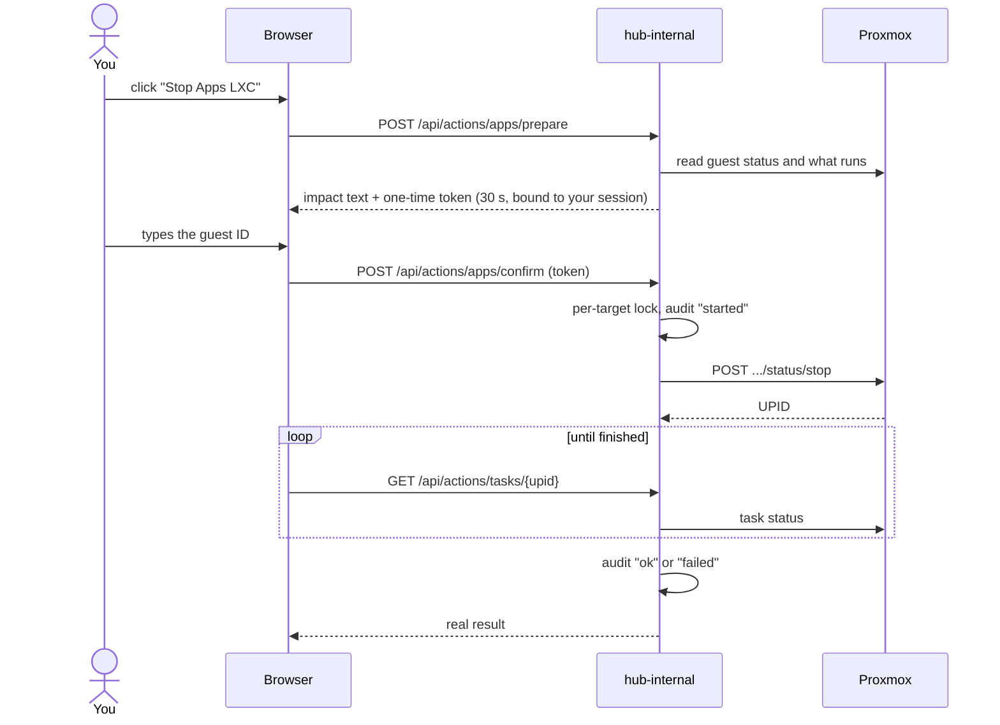

### Editing config safely

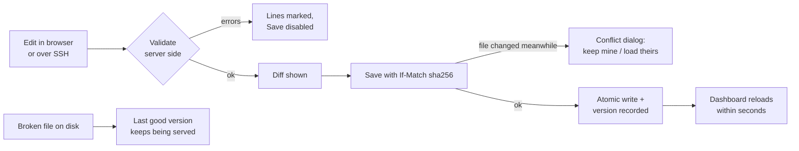

### Publishing the portfolio

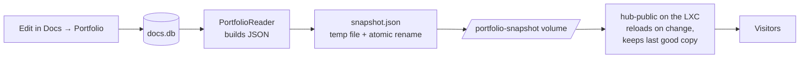

## Design decisions

| Decision | Why |
|---|---|
| **Separate containers, snapshot file between them** (the editor and the public portfolio are both on the Docs LXC) | The public side cannot be exploited into doing anything privileged because it has nothing privileged. SQLite in WAL mode also misbehaves on read-only mounts, so sharing the database was rejected. |
| **Java 17, Spring Boot 3.5, plain JDBC (`JdbcClient`), Flyway, SQLite** | Familiar, boring and fast to test on a Pi; the schema is small, so Hibernate's community SQLite dialect was not worth it. Pragmas (WAL, foreign keys, busy timeout) are set per connection in the JDBC URL. |
| **`dashboard.yaml` is opaque text with validation** | The text file is the source of truth (editable over SSH). Form-assisted edits insert or cut text at the right place instead of re-serialising, so comments and layout survive. Only layouts the editor does not understand fall back to re-formatting, and the UI says so. |
| **YAML parsed compose-only** | SnakeYAML's constructors are not used and aliases are refused, which removes the object-construction and alias-bomb classes of YAML attacks. |
| **Secrets are references** | Credentials are `${secret:NAME}` in the YAML, resolved from environment (`HUB_SECRET_NAME`) or `secrets.env`. A plaintext credential in the YAML is a validation **error**. |
| **Status: unknown is not down** | A failed *check* (for example ping not available) is shown as unknown, never as an outage. |
| **Certificate pinning for Proxmox** | Proxmox uses a self-signed certificate. Trusting any certificate would let anyone on the LAN capture the API token; the app pins the SHA-256 fingerprint instead (`system` and `insecure` modes exist, explicit). |
| **Host networking for `hub-internal`** | Wake-on-LAN needs a real LAN broadcast. Exposure is governed by the host firewall instead of Docker port publishing. |
| **Skill filter replaces the old graph** | One page with a filter panel that affects every section is easier to use than separate graph pages. Skills are linked to roles, projects and homelab items, so a filter answers "show me everything where I used X". |
| **No runtime third-party requests** | Fonts are self-hosted, icons are downloaded once into the data folder (`tools/fetch-icons`), and the CSP allows only `'self'`. |

## Data model

SQLite, managed by Flyway (`hub-internal/src/main/resources/db/migration`).

```mermaid
erDiagram
    profile
    experiences ||--o{ experience_skills : uses
    projects ||--o{ project_skills : uses
    projects ||--o{ project_deliverables : has
    projects ||--o| project_case_studies : has
    skill_groups ||--o{ skills : contains
    skills ||--o{ skill_aliases : "known as"
    skills ||--o{ experience_skills : links
    skills ||--o{ project_skills : links
    homelab_devices ||--o{ homelab_containers : hosts
    homelab_devices ||--o{ homelab_services : runs
    homelab_devices ||--o{ homelab_network_entities : has
    homelab_devices ||--o{ device_skills : uses
    homelab_containers ||--o{ container_skills : uses
    homelab_services ||--o{ service_skills : uses
    skills ||--o{ device_skills : links
    skills ||--o{ container_skills : links
    skills ||--o{ service_skills : links
    academic_items
    unlinked_tags
    audit_log
    config_versions
    kv
    budget_people ||--o{ budget_expenses : "paid"
    budget_expenses ||--o{ budget_expense_shares : "split into"
    budget_people ||--o{ budget_expense_shares : "owes share"
    budget_recurring ||--o{ budget_recurring_people : "split among"
    budget_recurring ||--o{ budget_expenses : "creates"
    budget_recurring ||--o{ budget_recurring_skips : "deleted months"
    budget_people ||--o{ budget_settlements : "pays / is paid"
```

Every editable row has a `version` column for **optimistic locking** (two browser tabs cannot silently overwrite each other).
Operational tables: `audit_log` (who did what to which target, with the result), `config_versions` (last 50 versions of
`dashboard.yaml`), `kv`. A nightly `VACUUM INTO` backup keeps the last 14 copies (it copies the whole database, so it includes
the budget; a test checks that).

Budget tables (`V4__budget.sql`): money is stored as **integer paise**, never floating point. Each expense stores its per-person
shares (so adding a person later never changes old expenses). A generated recurring entry keeps a link to its definition; when it
is deleted a skip row stops it being created again. Migration `V3` is deliberately left free for the planned Terminal feature,
and Flyway runs with `out-of-order` enabled so that a `V3` added later still applies on a database that already has `V4`.

## Configuration

### `dashboard.yaml`

```yaml
version: 1
title: Homelab
defaults: {status: auto, interval: 30}      # auto: quick TCP check for http(s) links

widgets:
  - resources: {cpu: true, memory: true, disk: /, cputemp: true, uptime: true, network: true}
  - search: {provider: duckduckgo}          # google | duckduckgo | bing

pinned: [wake-nas, apps]                    # "Quick actions" row

groups:
  - name: Proxmox
    items:
      - name: Proxmox VE
        href: https://192.168.10.102:8006
        icon: proxmox.svg                   # name (downloaded once), /images/x.png, or https URL
        status: {tcp: "192.168.10.102:8006"}
        widget:
          type: proxmox
          url: https://192.168.10.102:8006
          node: pve
          username: "root@pam!homepage"
          password: "${secret:PVE_PASSWORD}"   # never plaintext
      - name: Power
        items:                                # nested group
          - {name: Wake NAS, action: wake-nas}

actions:
  - {id: wake-nas, label: Wake NAS, type: wol, mac: "AA:BB:CC:DD:EE:FF", status: {icmp: 192.168.10.50}}
  - {id: pve-off,  label: Shutdown Proxmox, type: proxmox-node, node: pve, command: shutdown}
  - {id: apps,     label: Apps LXC, type: proxmox-guest, node: pve, kind: lxc, vmid: 100}
```

- Status checks: `tcp: host:port`, `http: url` (optional `expect:` status code, `tls:`), `icmp: host`.
- Widget types: `resources`, `search`, `proxmox`, `proxmoxbackupserver`, `filebrowser`, `qbittorrent`.
- Action types: `wol`, `proxmox-node` (`shutdown` | `reboot`), `proxmox-guest` (`lxc` | `qemu`).
- Unknown keys, bad URLs, duplicate action ids, actions referenced but missing, and plaintext credentials are reported with line numbers.
- Optional `terminals:` for the Terminal page (see *Terminal setup*). Only hosts listed here can ever be connected to; the key is a
  file **name** inside `$HUB_DATA/hub/ssh/`, never a path, and `hostKey` pins the server's SSH host key:

```yaml
terminals:
  - id: pi                       # used in the URL: #/terminal/pi
    label: Raspberry Pi
    host: 127.0.0.1
    port: 22                     # default 22
    user: hubshell
    key: hub_terminal_ed25519    # file in $HUB_DATA/hub/ssh/ (mode 600, owner uid 10001)
    hostKey: "SHA256:..."        # from `terminal-hostkey`, compared with `ssh-keygen -lf` on the host
```

- Optional `dockerHosts:` for the Docker page (see *Docker setup*): the same fields as `terminals:` plus `protect:` (container names
  the page may never stop, restart, update or remove). Containers labelled `com.homelabhub.self=true` (the hub's own) are always protected.

```yaml
dockerHosts:
  - id: pi
    label: Raspberry Pi
    host: 127.0.0.1
    user: hubdocker
    key: hub_docker_ed25519
    hostKey: "SHA256:..."
    protect: [pihole]
  - id: media
    label: Media LXC
    host: 192.168.1.50
    user: hubdocker
    key: hub_docker_ed25519
    hostKey: "SHA256:..."
```

### Environment (`deploy/.env`, see `deploy/.env.example`)

| Variable | Purpose |
|---|---|
| `HUB_PASSWORD_HASH` | bcrypt hash of the dashboard password (`hash-password` command). Double every `$` for compose. |
| `HUB_AUTH_MODE` | `all` (default: whole dashboard needs the password), `edit` (only editors), `none` |
| `HUB_ALLOWED_HOSTS` | extra host names the dashboard answers to (IP addresses and `localhost` always work) |
| `HUB_SECURE_COOKIES` | `true` marks the session and CSRF cookies `Secure`. Only when every way of opening the dashboard is https (see *Install on a phone*); default `false` |
| `HUB_BUDGET_ZONE` | time zone for "today" on the Budget page (settlement dates, "This month" export); default `Asia/Kolkata` |
| `HUB_PORT` / `HUB_PUBLIC_PORT` | 3010 / 3011 |
| `HUB_DATA` | host folder for the data volume |
| `PROXMOX_API_URL`, `PROXMOX_API_TOKEN` | Proxmox API access (`user@realm!tokenid=secret`) |
| `PROXMOX_TLS_MODE`, `PROXMOX_TLS_FINGERPRINT` | `pinned` (default), `system` or `insecure` |
| `HUB_INTERNAL_JAVA_OPTS`, `HUB_PUBLIC_JAVA_OPTS` | JVM flags (default heap `-Xmx256m` / `-Xmx160m`) |
| `HUB_TERMINAL_ENABLED` | `true` turns the Terminal page on (default `false`). Ignored when `HUB_AUTH_MODE=none` or no password is set |
| `HUB_TERMINAL_IDLE_SECONDS`, `HUB_TERMINAL_MAX_SECONDS`, `HUB_TERMINAL_MAX_SESSIONS` | terminal limits: 900 / 7200 / 2 |
| `HUB_DOCKER_ENABLED` | `true` turns the Docker page on (default `false`). Ignored when `HUB_AUTH_MODE=none` |
| `HUB_DOCKER_COMMAND_TIMEOUT_SECONDS`, `HUB_DOCKER_JOB_TIMEOUT_SECONDS`, `HUB_DOCKER_LOG_FOLLOW_MAX_SECONDS` | Docker limits: 20 / 900 / 1800 |

### Data folder (`$HUB_DATA/hub`)
`hub.db` · `config/dashboard.yaml` · `secrets.env` (`chmod 600`, lines `NAME=value`) · `images/` (portfolio images at `/images/`,
downloaded icons in `images/icons/`) · `backups/` (nightly, last 14) · `ssh/` (the Terminal and Docker pages' private keys, mode 600, owner uid 10001). The portfolio no longer lives here: its tables stay in `hub.db` untouched as the rollback copy (see the cutover in `docs/docs-setup-guide.md`).

## Security

**Threat model.** `hub-internal` is trusted-network only (LAN and Tailscale) and holds the dangerous capabilities (Proxmox token,
power actions, edit rights) and now exposes nothing to the internet. The only internet-facing parts are `docs-public` and `hub-public` on the Docs LXC. The goal is that a compromise or mistake on the public
side cannot reach the privileged side, and that a mistake in the browser cannot power off a host by accident.

| Area | Controls |
|---|---|
| **Public surface** | Separate container with no DB driver, no Proxmox client, no Spring Security (enforced at build time). Reads a sanitised snapshot only, size-capped, keeps its last good copy. Public bundle is checked for leaked admin code. Non-root user, read-only root filesystem, all capabilities dropped, `no-new-privileges`. |
| **Login** | One password, bcrypt (cost 12). Session cookie `HUBSESSION` is `HttpOnly; SameSite=Strict`. No default or generated password: with no hash set, login is impossible. Failed logins are rate limited: per client 5 failures per 15 minutes trigger an escalating lockout (30 s up to 15 min), and a global cap of 30 failures per 10 minutes. |
| **CSRF and origin** | Cookie-to-header CSRF token on all state changes. `Host` header allowlist against DNS rebinding. |
| **Content security** | Strict CSP (`script-src 'self'`, no third-party origins, `frame-ancestors 'none'`, `form-action 'self'`), `nosniff`. Self-hosted fonts and icons. Links from config are checked for scheme, external links use `rel="noopener noreferrer"`, icon names cannot escape their folder. |
| **Power actions** | Prepare/confirm with a **one-time token bound to one action and one session, valid 30 s**. Typed confirmation for destructive actions. Per-target in-flight lock (a second click answers 409). Every attempt goes to `audit_log`. Guest and node identifiers are validated before any Proxmox call. |
| **Proxmox** | Certificate **pinning** by default, 3 s connect and 10 s request timeouts, no redirects, task IDs (UPIDs) validated, the token never appears in logs or error messages. |
| **Secrets** | Only as `${secret:NAME}` references; values live in `secrets.env` (mode 600) or environment. A plaintext credential in the YAML is a validation error. The client never receives secrets or hidden URLs. |
| **Config parsing** | YAML parsed without object construction, aliases refused, size limits, atomic writes, `If-Match` on save. |
| **Budget** | Everything under `/api/admin/budget`, so it needs the login in both `all` and `edit` modes and CSRF on writes (tested). Field-by-field server validation with caps (₹10,00,00,000.00 per amount, 50 people, months 2000-01..2100-12, statements up to 5 years), optimistic locking, bound SQL parameters only. The PDF file name is made by the server, never from user text; text the PDF font cannot draw is replaced, not trusted. |
| **Portfolio writes** | In `docs-internal` now, behind the Docs login (`DOCSSESSION`, all auth modes and CSRF tested). Server-side validation of every field (slugs, enums, URLs with unsafe schemes refused), optimistic locking, transactional writes, snapshot written atomically. The hub has no portfolio routes any more (they answer 404). |
| **Legacy routes** | Kept open on purpose (no login) so existing callers keep working, but a `Sec-Fetch-Site: cross-site` guard stops a web page in your browser from triggering them, and they share the per-target lock and audit log. |
| **Terminal** | Off unless `HUB_TERMINAL_ENABLED=true`; refuses to turn on without a login. Every route (and the WebSocket) is under `/api/admin`. The dashboard password is asked again for every session (**step-up**), checked with the same rate limiter as the login, and exchanged for a **one-time ticket** (30 s, bound to the login session and host) that the WebSocket presents as its first message, never in a URL. The upgrade needs the session cookie, a same-site `Origin` (cross-site WebSocket hijacking) and an allowed `Host`. Only hosts in `dashboard.yaml`; the SSH host key is **pinned** and checked before authenticating; the key file is a name inside `ssh/` (symlinks out of it refused); public-key auth only, no agent/port/X11 forwarding. The shell user `hubshell` has no sudo and its key only works from `127.0.0.1`. Idle/max-time/concurrency/message-size/output-queue limits. Sign-out closes the session. Audit keeps metadata only; tickets, passwords and terminal content are never logged. |
| **Docker page** | Off unless `HUB_DOCKER_ENABLED=true`; refuses to turn on without a login; every route under `/api/admin` (login + CSRF). Only hosts in `dashboard.yaml`, reached over SSH with the same pinned-host-key, key-file-by-name and public-key-only rules as the Terminal. The browser only sends a host id and a container id: commands are built on the server from a fixed set of verbs, every value checked against a strict pattern **and** single-quoted; file contents and environment values travel on the SSH channel's stdin, never on a command line. Changes are prepare/confirm with a one-time token bound to the browser session (30 s), destructive ones need the name typed; the hub's own containers and `protect:` entries are refused. Audit keeps who/what/result only. The `hubdocker` user is in the `docker` group, which is **root on that host**: see *Known limitations*. |
| **Containers** | Non-root users, dropped capabilities (`internal` keeps only `NET_RAW` for ping), `no-new-privileges`, read-only root, `/tmp` on tmpfs. |

| **Docs** | Separate machine (its own LXC), its own login (`DOCSSESSION`, same hub-auth code and limits), its own Cloudflare tunnel; no credentials for the Pi and no network path to it. `docs-public` has no host port (only `cloudflared` on the compose `edge` network reaches it), no DB driver and no Spring Security (enforcer rule), serves one page per hostname from a read-only snapshot, and only the files that page lists, looked up by hash. Page bodies are whitelisted ProseMirror JSON, never HTML; link schemes are checked on save and at render; SVG only through ``. Webapps run in `sandbox="allow-scripts"` (no same-origin) and their files carry a `sandbox` CSP; the internal preview uses HMAC-signed paths valid 1 h. ZIP uploads are checked for traversal, symlinks, bombs and file types while reading. |

### Deployment hardening you must do
- Publish only `hub-public` and `docs-public` (port 3011, through the `docs` tunnel on the LXC). Never route `hub-internal` or `docs-internal`.
- Firewall: allow 3010 only from your LAN and Tailscale.
- Use a Proxmox API token limited to the permissions the buttons need.

## API overview

Everything under `/api` (except `/api/auth/*` and legacy routes) needs a session on `hub-internal`. OpenAPI is not generated; this is the surface:

| Area | Routes |
|---|---|
| Auth | `GET /api/auth/status`, `POST /api/auth/login`, `POST /api/auth/logout` |
| Dashboard | `GET /api/dashboard`, `GET /api/status`, `POST /api/status/refresh`, SSE stream of status changes |
| Widgets | `GET /api/widgets/item/{id}`, `GET /api/widgets/info/{type}` |
| Actions | `POST /api/actions/{id}/prepare`, `POST /api/actions/{id}/confirm`, `GET /api/actions/tasks/{upid}` |
| Config | `GET/PUT /api/admin/config`, `POST /api/admin/config/validate`, `GET /api/admin/config/versions`, `POST .../versions/{id}/restore` |
| Portfolio admin (**on `docs-internal`**, not the hub) | `GET /api/portfolio`, `GET /api/admin/portfolio/schema`, `GET /api/admin/portfolio/config`, generic CRUD `GET/POST/PUT/DELETE /api/admin/portfolio/{resource}[/{id}]`, `.../{id}/skills`, `.../{id}/tags`, `.../{id}/usage`, `POST /api/admin/portfolio/republish`, `GET .../publish-status` |
| Backups | `GET/POST /api/admin/backups` |
| Terminal | `GET /api/admin/terminal/config`, `POST /api/admin/terminal/sessions` (step-up, returns a ticket), `GET /api/admin/terminal/audit`, WebSocket `/api/admin/terminal/ws` |
| Docker | `GET /api/admin/docker/config`, per host `GET .../hosts/{id}/containers`, `.../stats`, `.../networks`, `.../containers/{cid}/logs?tail=`, `.../logs/stream` (SSE), `POST .../containers/{cid}/{start\|stop\|restart\|remove\|update}/prepare`, stacks `GET/POST .../hosts/{id}/stacks`, `GET/PUT .../stacks/{name}`, `GET .../stacks/{name}/versions`, `POST .../stacks/{name}/{deploy\|pull\|stop\|down\|delete}/prepare[?volumes=true]`, `POST .../hosts/{id}/run/prepare`, then `POST /api/admin/docker/confirm` `{token, typed}`; `GET .../jobs/{id}`, `GET .../jobs`, `GET .../audit` |
| Budget | `GET/POST /api/admin/budget/people`, `PUT .../people/{id}`, `POST .../months/{yyyy-MM}/open` (month view; creates due recurring entries), `GET .../history`, `POST .../expenses`, `PUT/DELETE .../expenses/{id}`, `GET/POST .../recurring`, `PUT/DELETE .../recurring/{id}`, `POST .../settlements`, `DELETE .../settlements/{id}`, `GET .../statement?from&to`, `GET .../export.pdf?from&to`. All amounts are integer paise. |
| Legacy (open) | `GET /wake/mac/{mac}`, `POST /wake`, `GET/POST /toggle...`, `GET /node/{node}/shutdown`, `GET /node/{node}/reboot` |
| Public (`hub-public`, on the Docs LXC) | `GET /api/public/portfolio`, `GET /api/public/health` |

## Repository layout

```
homelab-hub/
├─ hub-snapshot/        DTO records for the snapshot (no Spring, no JDBC)
├─ hub-public/          read-only portfolio server (depends only on hub-snapshot + spring-web); runs on the Docs LXC
├─ hub-internal/        the privileged app on the Pi: auth, config, status, widgets, actions, budget, backup, legacy routes, terminal, Docker
├─ docs-internal/       the Docs app on the LXC: pages, the portfolio editor and its `import` / `migrate-portfolio` commands
├─ web/                 Vite + React + TypeScript
│  ├─ src/public        public entry (portfolio only)
│  ├─ src/internal      dashboard, config editor, budget page, action runner, terminal, Docker
│  ├─ src/shared        styles, portfolio page and editor (shared/portfolio), skill panel, palette, filters, API client
│  ├─ scripts           public-bundle leak check, docs-internal lazy-chunk check
│  └─ e2e               Playwright browser tests + test dashboard config
├─ deploy/              Dockerfiles, docker-compose.yml, .env.example
├─ scripts/             build-all.sh, e2e.sh, run-local.sh, stop-local.sh
├─ tools/               export-portfolio, convert-homepage, fetch-icons, mock-proxmox, mock-ssh
├─ contract/            responses recorded from the real legacy service and a real Proxmox (used as test fixtures)
└─ docs/                plan.md (design, decisions, progress log), mockups, screenshots
```

## Build and test

Prerequisites: JDK 17, Maven, Node 22+, Python 3, Chromium (for the browser tests).

```bash
scripts/build-all.sh     # web unit tests + build, copies both SPAs into the jars, then `mvn verify` (all Java tests)
scripts/e2e.sh           # starts the stack locally (mock Proxmox, local UDP listener) and runs the browser tests, then the Docs stack and its tests
scripts/run-local.sh     # just start the hub (dashboard :3910) for manual testing; stop-local.sh stops it
scripts/run-local-docs.sh # start Docs :3920, docs-public :3921 and the public portfolio :3911; stop-local-docs.sh stops it
scripts/check-deploy.sh  # static checks of both compose files (no depends_on, nothing public on the Pi)
```

| Suite | Count | What it covers |
|---|---|---|
| Java (JUnit 5, AssertJ, WireMock, Awaitility, spring-security-test, Apache MINA SSHD as a test SSH server) | 708 (543 `hub-internal`, 26 `hub-auth`, 26 `hub-public`, 104 `docs-internal`, 9 `docs-public`) | legacy contract against recorded responses, Proxmox client against real fixtures (TLS pinning, timeouts), auth/CSRF/host rules, config parser and store, status poller, widgets, actions and tokens, backup, schema pragmas; the portfolio (now in `docs-internal`): CRUD, importer, snapshot publisher, the hub-to-Docs schema parity, `migrate-portfolio` (every table and column copied, source file hash unchanged, refuses a non-empty target, dry run, corrupt or foreign source), the portfolio API in every auth mode; the hub: portfolio routes answer 404, migrations V1-V5 unchanged; budget: exact paise maths with randomised property checks, the reference statement, recurring entries, validation, locking, login in both auth modes, the PDF (glyphs, figures, pagination); terminal end to end (real WebSocket + real SSH server: step-up, tickets, Origin/Host, limits, idle, logout, slow clients, host-key pinning, nothing sensitive logged); the hub's headers unchanged after the hub-auth move; Docs: tree moves and cycles, the page whitelist, ZIP attacks (traversal, symlinks, bombs), hostnames, preview tokens, the API in every auth mode with CSRF and 409s, the publisher (write order, simulated crashes, link rewriting, delayed clean-up), docs-public routes (one page per host, foreign files 404) |
| Web unit (Vitest) | 126 | Docs renderer (every node, unsafe links dropped, no raw HTML), the frame height guard, tree/drag logic, slash menu, history diff; filter logic, YAML text editing (add/remove, comments preserved, CRLF, flow lists), diff, utilities, icon resolution, the service worker's caching rules, budget money parsing/formatting and dates (same vectors as the Java side), terminal key mapping and protocol |
| Browser (Playwright) | 70 run here (43 hub + 27 Docs and portfolio), plus 14 terminal and Docker tests that need `paramiko` for the mock SSH server | Docs: own login, tree drag and drop and Move to, every editor block incl. Mermaid and uploads, conflicts, a ZIP webapp that cannot reach Docs, publishing by hostname (internal links plain text, unknown host 404), unpublish, phone; **the portfolio**: the public site from the migrated data, editing in Docs and seeing it on the public site, field errors, skill links, layout at four screen sizes, and **stopping `docs-internal` while the public portfolio and a public Docs page keep answering, then starting it again**; hub: the Docs link and the Portfolio link card (and that the dashboard makes no request to the Docs host or any portfolio API), login, dashboard, real Wake-on-LAN packets received, typed confirmations, task following, expiry, config editor and conflicts, tile sizes, dialogs on short screens, installability (manifest, icons, service worker, nothing private cached), no horizontal overflow at phone and desktop widths; budget: nothing loads until the page is opened, forms, part payments, carry-over, recurring entries, export preview and PDF download, phone and short screens; terminal: against a real shell (lazy loading, step-up, Ctrl+C via the key row, resize, idle close, limits, sign-out, phone layout) |
| Python (unittest) | 28 | exporter, converter, mock Proxmox, mock SSH server |

Nothing in the local scripts touches a real Proxmox or a real credential.

## Deploy

Deployment targets a Raspberry Pi 4 (arm64) running Docker; images are built on the Pi from the jars.

```bash
scripts/build-all.sh                                   # on a dev machine, or build the jars on the Pi
docker compose -f deploy/docker-compose.yml --env-file deploy/.env up -d --build
```

First-time steps: create the password hash (`printf 'pw\n' | java -jar hub-internal/target/*.jar hash-password`), copy
`deploy/.env.example` to `deploy/.env`, pin the Proxmox certificate
(`java -jar hub-internal.jar fingerprint <host>:8006`, and compare it with the Proxmox UI before trusting it), create
`$HUB_DATA/hub/secrets.env`, and download icons with `tools/fetch-icons`. The portfolio is set up on the Docs LXC: `docs-internal.jar import` (from the
old Postgres export) or `migrate-portfolio --from <hub backup>` (from an existing hub, see `docs/docs-setup-guide.md`).

Command-line tools built into the hub jar: `hash-password`, `fingerprint`, `validate-config`, `terminal-hostkey` (`import` now only points to Docs). Built into the Docs jar: `hash-password`, `import`, `migrate-portfolio`.

### Terminal setup
The Terminal page is off until you do these steps. They change the Pi, so read each one first. The shell runs as a **new unprivileged
user `hubshell`**, not your main account (which has passwordless sudo, so a terminal as that user would be root).

```bash
# 1. the unprivileged account (no sudo group). The password is only used if you add the optional sudo rule in step 2.
sudo adduser --disabled-password --gecos "" hubshell
sudo passwd hubshell
# 2. OPTIONAL, only if you want root inside the terminal: sudo that ASKS for hubshell's password (never NOPASSWD)
echo 'hubshell ALL=(ALL:ALL) ALL' | sudo tee /etc/sudoers.d/hubshell >/dev/null
sudo chmod 440 /etc/sudoers.d/hubshell && sudo visudo -cf /etc/sudoers.d/hubshell
# 3. a dedicated key for the hub, only valid for connections from the Pi itself
ssh-keygen -t ed25519 -N "" -C homelab-hub-terminal -f /tmp/hub_terminal_ed25519
sudo install -d -m 700 -o hubshell -g hubshell /home/hubshell/.ssh
echo "from=\"127.0.0.1,::1\",no-agent-forwarding,no-port-forwarding,no-X11-forwarding $(cat /tmp/hub_terminal_ed25519.pub)" \
  | sudo tee /home/hubshell/.ssh/authorized_keys >/dev/null
sudo chown hubshell:hubshell /home/hubshell/.ssh/authorized_keys && sudo chmod 600 /home/hubshell/.ssh/authorized_keys
sudo install -d -m 700 -o 10001 -g 10001 $HUB_DATA/hub/ssh
sudo install -m 600 -o 10001 -g 10001 /tmp/hub_terminal_ed25519 $HUB_DATA/hub/ssh/hub_terminal_ed25519
shred -u /tmp/hub_terminal_ed25519 /tmp/hub_terminal_ed25519.pub
# 4. the host key to pin: these two must print the SAME fingerprint
ssh-keygen -lf /etc/ssh/ssh_host_ed25519_key.pub
docker exec hub-internal java -jar /app/hub-internal.jar terminal-hostkey 127.0.0.1:22
# 5. add the `terminals:` entry (see Configuration) in the Config page, set HUB_TERMINAL_ENABLED=true in deploy/.env,
#    and restart hub-internal
```

Never add `hubshell` to the `docker` group: that is root-equivalent. The terminal works through `tailscale serve` as it is (it is a
same-origin WebSocket), and over the LAN address. Sessions end when the browser disconnects (a phone going to sleep, closing the
tab): run long jobs inside `tmux`.

### Docker setup
The Docker page is off until you do these steps, once per Docker host (the Pi itself, and each Proxmox LXC/VM that runs Docker).
They change those machines, so read each one first. The hub logs in as a **dedicated user `hubdocker`** that is in the `docker`
group. That group is root-equivalent on that host, which is what managing containers needs; it is never `hubshell`.

```bash
# On the Pi, once: one key for the hub, used for every Docker host
ssh-keygen -t ed25519 -N "" -C homelab-hub-docker -f /tmp/hub_docker_ed25519
sudo install -d -m 700 -o 10001 -g 10001 $HUB_DATA/hub/ssh
sudo install -m 600 -o 10001 -g 10001 /tmp/hub_docker_ed25519 $HUB_DATA/hub/ssh/hub_docker_ed25519
cat /tmp/hub_docker_ed25519.pub   # copy this line for the hosts below, then: shred -u /tmp/hub_docker_ed25519*

# On EACH Docker host: the user (bash: the hub's commands need a POSIX shell), Docker access, and the key.
# from= limits the key to the Pi: 127.0.0.1,::1 on the Pi itself, the Pi's LAN address on other hosts.
# restrict turns off forwarding; pty is needed only for following logs live.
sudo adduser --disabled-password --gecos "" --shell /bin/bash hubdocker
sudo usermod -aG docker hubdocker
sudo install -d -m 700 -o hubdocker -g hubdocker /home/hubdocker/.ssh
echo 'from="192.168.1.2",restrict,pty ssh-ed25519 AAAA...the line copied above...' \
  | sudo tee /home/hubdocker/.ssh/authorized_keys >/dev/null
sudo chown hubdocker:hubdocker /home/hubdocker/.ssh/authorized_keys && sudo chmod 600 /home/hubdocker/.ssh/authorized_keys
docker compose version            # Compose v2 (the plugin) is needed for stacks and Update
ssh-keygen -lf /etc/ssh/ssh_host_ed25519_key.pub   # the host key fingerprint to pin

# Back on the Pi: must print the SAME fingerprint as above
docker exec hub-internal java -jar /app/hub-internal.jar terminal-hostkey 192.168.1.50:22
# Then add the host to `dockerHosts:` (see Configuration) in the Config page, set HUB_DOCKER_ENABLED=true in deploy/.env,
# and restart hub-internal (new hosts later only need the YAML entry).
```

- **Proxmox LXC:** Docker inside an unprivileged LXC needs the container's `nesting=1` (and usually `keyctl=1`) feature, and sshd
  installed in the LXC (`apt install openssh-server`). The hub reaches the LXC on its LAN address like any other host.
- **Stacks** live on each host in `~hubdocker/stacks/<name>/` (`compose.yaml` and `.env`, mode 600), so they are ordinary compose
  projects you can also manage over SSH. Compose projects started elsewhere (like the hub itself) show as *external*: their
  containers can be updated from the page, but their files are not edited here.
- The hub's own `deploy/docker-compose.yml` labels both hub containers `com.homelabhub.self=true`, so the page can never stop the hub.
  Re-create them once (`docker compose ... up -d`) after updating so the label is applied.
- **Clean up…** (per host) lists the images no container uses, running or stopped, and the networks nothing is attached to. You
  tick what to remove and confirm; each item is removed on its own with `docker rmi` / `docker network rm` (never `-f`, so Docker
  still refuses anything in use), and each one is in the audit log.
- **Live memory shows "n/a"** when the host reports no memory limit at all (`0B / 0B`): its kernel has no memory cgroup, so Docker
  reads 0 for every container. On a Raspberry Pi, `cgroup_enable=memory` in `/boot/firmware/cmdline.txt` (and a reboot) turns it on.

### Install on a phone (PWA)
The dashboard is an installable web app (manifest, icons, a small service worker, an app shortcut for Config). Android only
offers a real install, and only runs the service worker, over **https**, so put the Pi's Tailscale HTTPS address in front of it:

1. In the Tailscale admin console enable MagicDNS and **HTTPS Certificates** for the tailnet.
2. On the Pi: `sudo tailscale serve --bg http://127.0.0.1:3010` (it prints the `https://<pi>.<tailnet>.ts.net` address).
3. Add that host name (without `https://`) to `HUB_ALLOWED_HOSTS` in `deploy/.env` and restart `hub-internal`.
4. Open the address in Chrome on the phone (Tailscale connected) and choose **Install app**.
5. Optional, only if you will always use the https address: `HUB_SECURE_COOKIES=true`.

Over plain http on the LAN the site works as before (you can still add a browser shortcut), but it is not an installed app.
The service worker stores only the fingerprinted JavaScript/CSS files and an "offline" page. It never stores API responses or pages,
so nothing private stays on the phone, and when the server cannot be reached it shows a clear message instead of a browser error.

### Icons
Icon names in the YAML (`proxmox.svg`, `grafana.png`, `guacamole`, `mdi-home`) are served from `$HUB_DATA/hub/images/icons/`. After
adding a service run:
`python3 tools/fetch-icons/fetch_icons.py <dashboard.yaml> $HUB_DATA/hub/images/icons` (needs `pyyaml`). It downloads them once from the
dashboard-icons and Material Design Icons repositories. A missing icon shows a letter badge.

## Operations

- **Backup:** copy `$HUB_DATA/hub` (the nightly `backups/*.db` files are consistent SQLite copies). Restore: stop, place a backup as `hub.db`, start. Dashboard YAML versions can be restored from the Config page.
- **Updates:** rebuild and redeploy. Watchtower is deliberately excluded (label `com.centurylinklabs.watchtower.enable=false`) because the images are built locally and exist in no registry.
- **Memory limits:** some Raspberry Pi kernels have no memory cgroup, so container `mem_limit` does nothing there. The JVM heap is therefore set explicitly (`-Xmx`).
- **Logs:** `docker logs hub-internal`. The audit log is in the database (`audit_log`).
- **Public site stale?** Docs shows *Portfolio out of date* in its top bar; in the portfolio editor a *Retry publishing* button appears if publishing failed (it also retries by itself every 30 s).
- **Stop Docs but keep the portfolio online:** `docker compose -f deploy/docs/docker-compose.yml stop docs-internal docs-public` (start again with `start`). `hub-public`
  and `cloudflared` keep serving the last snapshot. Stopping the **whole LXC** takes the portfolio offline, and never affects the Pi.

## Measured on a Raspberry Pi 4

Single sample on a Pi 4 (8 GB), JDK 17 in Docker, a few minutes of use. Not a long-run or leak test.

| | `hub-internal` | `hub-public` (measured on the Pi, before it moved to the LXC) |
|---|---|---|
| RSS idle → after ~1000 requests | 233 → 243 MiB | 157 → 177 MiB |
| Startup | ~30 s | ~20 s |
| Idle CPU | ~0.6 % of one core | ~0.1 % |
| Throughput / latency (4 concurrent) | dashboard 92 req/s, p95 85 ms | 200 req/s, p95 34 ms |
| Image size | 364 MB | 340 MB |

For comparison, the two old containers replaced here used about 390 MiB together, without the portfolio's three services.

## Tools

| Tool | What it does |
|---|---|
| `tools/export-portfolio` | one-off exporter from the old Postgres portfolio to JSON, with a reviewed skill-mapping step (`skill-mapping-decisions.accepted.csv`) |
| `tools/convert-homepage` | converts a gethomepage `services.yaml` to `dashboard.yaml`; credentials are never copied, they become `${secret:NAME}` references |
| `tools/fetch-icons` | downloads the icons a `dashboard.yaml` uses |
| `tools/mock-proxmox` | a small mock of the Proxmox API and a UDP listener, used by the browser tests |
| `tools/mock-ssh` | a throwaway SSH server (paramiko) with a real shell in a PTY, for the Terminal browser tests, and exec for the `hubdocker` user (Docker page tests); loopback only, keys generated per run |
| `tools/mock-docker` | a fake, stateful `docker` CLI (containers, logs, run, compose) that the mock SSH server puts on the PATH; never talks to a real Docker |

## Docs app

Docs runs on its **own Proxmox LXC** (`deploy/docs/`), not on the Pi. The design is in
[`docs/design-history/docs-feature-plan.md`](docs/design-history/docs-feature-plan.md); the step-by-step setup after deployment (LXC, Docker, Tailscale,
the Cloudflare tunnel and DNS, firewall, the hub link, backups) is in [`docs/docs-setup-guide.md`](docs/docs-setup-guide.md).

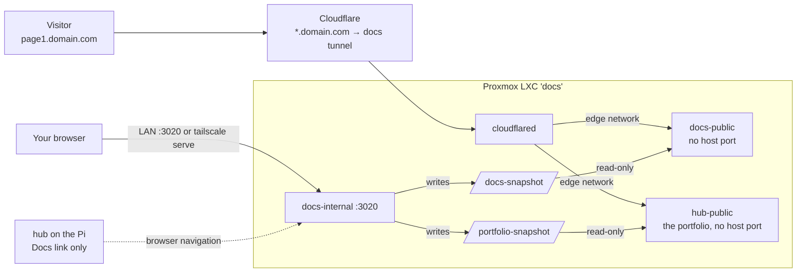

| Module | What |
|---|---|
| `hub-auth` | The login shared by the hub and Docs: password check, rate limiter, Host allowlist, CSRF, filter chain builder |
| `docs-internal` | Editor API, login, SQLite (`docs.db`), content-addressed blob store, history, Trash, the publisher that writes the snapshot; **the portfolio editor** (`#/portfolio`, `/api/admin/portfolio/**`) with its own snapshot publisher |
| `docs-public` | One read-only page per hostname from the snapshot; same dependency boundary as `hub-public` |
| `hub-public` | The public portfolio (unchanged code, now run from `deploy/docs/` on the LXC): no host port, `edge` network, reads `portfolio-snapshot` read-only |
| `web/src/docs-internal`, `web/src/docs-public`, `web/src/shared/docs` | The editor app, the public page, and the shared renderer |

**Configuration** (`deploy/docs/.env`, see `.env.example`): `DOCS_PASSWORD_HASH` (bcrypt, every `$` doubled), `DOCS_AUTH_MODE`
(`all`/`edit`/`none`), `DOCS_ALLOWED_HOSTS`, `DOCS_SECURE_COOKIES`, `DOCS_HUB_URL` (the **← Hub** link), `DOCS_DOMAINS` (allowed
public hostname endings), `DOCS_PORT`, `DOCS_DATA`, `DOCS_MAX_ASSET_MB` / `DOCS_MAX_BUNDLE_MB`, `TUNNEL_TOKEN`,
`DOCS_INTERNAL_JAVA_OPTS` / `DOCS_PUBLIC_JAVA_OPTS` / `HUB_PUBLIC_JAVA_OPTS`, `DOCS_PORTFOLIO_URL` (the portfolio's public address,
shown as *Open public site*), `DOCS_PORTFOLIO_SNAPSHOT_DIR`. On the hub, `docs: {url: https://docs.<tailnet>.ts.net, portfolioUrl: https://<portfolio-host>}` in `dashboard.yaml`
adds the **Docs** link and the Portfolio card's *Edit in Docs* / *Open public site* buttons (http/https only, no credentials in the URL; `portfolioUrl` is optional).
The hub only links: it never calls the LXC, and nothing on the LXC calls the Pi.

**Webapp protocol.** An app runs in `<iframe sandbox="allow-scripts">`. It gets `?theme=light|dark` and later
`postMessage({type: "hub:theme", theme})`; for *auto* height it sends `parent.postMessage({type: "hub:height", px}, "*")` (accepted
only from that frame, clamped to 150-4000 px). The optional helper `<script src="_hub/hub-embed.js"></script>` does both. Apps can
load files from their own bundle (and `fetch` them), plus the CDNs ticked on the page (cdnjs, jsdelivr, unpkg).

**Build and test.** `scripts/build-all.sh` builds and tests everything, Docs included. `scripts/e2e.sh docs` starts
`docs-internal` on 3920, `docs-public` on 3921 and `hub-public` on 3911 (`scripts/run-local-docs.sh`, password `local-test-pass`; it imports
and migrates the real portfolio export when `.scratch/export-out/` has it) and runs the Docs and portfolio browser tests, including stopping and
starting `docs-internal` while both public sites keep answering; in the browser, `*.example.test` resolves to 127.0.0.1 so public pages are visited by hostname.

**Backups.** `docs-internal` backs up `docs.db` nightly (`VACUUM INTO`, 14 kept) into `DOCS_DATA/internal/backups`. The
`blobs/` folder (images, attachments, app files) is **not** in that copy: include `DOCS_DATA` in the Proxmox backup of the LXC.

## Known limitations and what is not verified

- **Legacy routes are open by design** (no login), so anyone on your LAN can call `/toggle/...`. Cross-site requests from a browser are refused, and every call is audited and locked per target.
- Over plain HTTP on the LAN the session cookie cannot be `Secure`. Serving the dashboard through Tailscale HTTPS (`tailscale serve`) and setting `HUB_SECURE_COOKIES=true` fixes that (see *Install on a phone*).
- The login lockout includes a global cap: someone on the LAN can lock you out for up to 10 minutes by failing logins.
- No request rate limit on power routes beyond the per-target lock.
- **Not verified end to end:** Proxmox shutdown and reboot of the real host by the app, the File Browser and qBittorrent widgets against live services at the time of writing, long-run memory behaviour, and file-change detection on every kind of bind mount (a 10-second poll is the fallback).
- Portfolio contact details (email, phone) are shown on the public page by design.
- **Terminal, accepted risk:** anyone who has the dashboard password gets a shell as `hubshell` on the Pi (the step-up only protects
  against a stolen session cookie). If the `hub-internal` container itself were compromised, the key in `$HUB_DATA/hub/ssh` gives the
  same. `hubshell` has no sudo and no Docker access unless you add them.
- **Terminal, not verified yet:** the WebSocket through the real `tailscale serve` on the Pi, Android Chrome/Gboard input quirks and the
  installed app on a phone, and memory use with open sessions on the Pi. Sessions are not kept when the browser disconnects (use `tmux`);
  sessions are not recorded, by design.
- **Docker, accepted risk:** the `hubdocker` user is in the `docker` group, which is root on that host. Anyone with the dashboard
  password can therefore run any container on every declared host (the run form and stacks allow host bind mounts, by design for a
  single-owner homelab; risky mounts like `/` or the Docker socket get a warning). If the `hub-internal` container were compromised,
  the key in `$HUB_DATA/hub/ssh` gives the same. Keep the key's `from=` restriction, and do not declare hosts you would not trust the
  dashboard with.
- **Docker, not verified yet:** everything was tested against a fake `docker` CLI behind an SSH server (Java tests and browser tests);
  output of the real Docker CLI is parsed from the documented `--format` fields, but it has not been run against real Docker on the Pi
  or an LXC. Update and Pull use `docker compose pull --ignore-buildable`, which needs a recent Compose v2 (check `docker compose pull --help` on each host). Jobs (pull/deploy output) are kept in
  memory only, so they are lost when the hub restarts; the audit log is kept. Live log follow needs the `pty` key option.
- **Budget, not verified yet:** sharing the PDF through the phone's share sheet (Web Share with files) on a real phone and inside
  the installed app, and PDF generation inside the real container on the Pi (read-only root filesystem; no font cache was written in
  local runs, because only the embedded fonts are used). "Who pays whom" uses a simple greedy plan: at most one payment fewer than
  the number of people, but not always the absolute minimum.
- **Docs, not verified yet:** a real deployment (the LXC, Docker inside it, `tailscale serve`, the Proxmox firewall), a real
  Cloudflare wildcard (`*`) public hostname on the docs tunnel, and memory use on the LXC. The Docs images were not built here
  (no Docker daemon in the development environment). A wildcard DNS record sends every subdomain without its own record to
  `docs-public`, which answers 404. The hub and Docs have separate passwords and sessions; changing one does not change the other.
  Full-text search covers page titles only.
- The Budget PDF uses Noto Sans (SIL Open Font License 1.1, license in `hub-internal/src/main/resources/fonts/OFL.txt`) because
  the standard PDF fonts have no ₹ sign. Noto Sans has no arrow glyph, so the PDF writes "Ravi paid Anu" instead of "Ravi → Anu".

## More

[`docs/plan.md`](docs/plan.md) has the full design document: decisions and their reasons, the assumptions that were checked, failure modes,
the delivery phases, and a dated progress log including the defects found and how they were fixed.

## License

[MIT](LICENSE). Use it, change it, learn from it. It comes with no warranty: it can power machines off and open shells, so read the
[Security](#security) section before pointing it at anything you care about.
