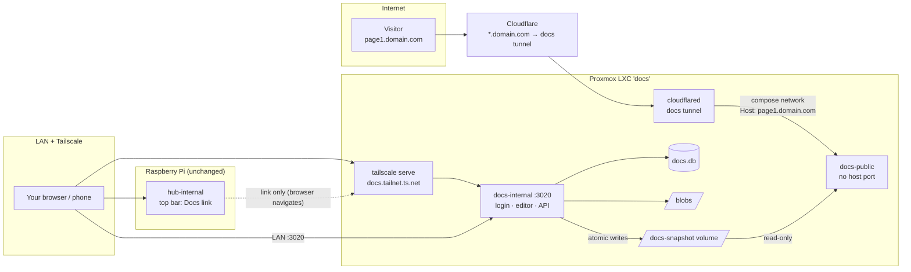

# Docs app for Homelab Hub: architecture and implementation plan

> Created: 2026-10-17 · Base: `main` at `bfa0868` · Status: **Implemented (2026-10-17, see `plan.md` §18.r), not deployed.** Mockups approved. Deployment revised: Docs runs on
> a dedicated Proxmox LXC; the hub on the Pi only links to it. Setup after deployment: `docs-setup-guide.md`.

This plan stands on its own. It was written from a design conversation with the owner (Tabish). You, the implementing
agent, have not seen that conversation, so everything you need is here. **Decided** means the owner chose it.
**Refinement** means a detail the owner has not explicitly confirmed. Mention every Refinement in your final report.

## 0. Read this first: project, git and working rules

### 0.1 The project and the three runtimes
"Homelab Hub" is a self-hosted app. Today it runs on the owner's Raspberry Pi 4 (arm64, Docker) as two containers:
`hub-internal` (port 3010, LAN and Tailscale only: dashboard, actions, editors, Budget, Terminal, Docker) and `hub-public`
(port 3011, the read-only portfolio behind the Pi's Cloudflare Tunnel).

**Docs is a separate app in the same repository, deployed on its own Proxmox LXC.** Nothing Docs-related runs on the Pi:

| Where | What | Exposure |
|---|---|---|
| Raspberry Pi (unchanged) | `hub-internal`, `hub-public` | Gains only a **Docs** link in the top bar (D-L2) |
| Docs LXC | `docs-internal`: editor, API, its own login, SQLite, blobs | LAN + Tailscale only, port 3020 |
| Docs LXC | `docs-public`: one public page per hostname, read-only | **No host port.** Reachable only from `cloudflared` on the compose network |
| Docs LXC | `cloudflared` for a **separate "docs" tunnel** | Outbound only |

The reason is isolation: the Pi holds the Proxmox API token and the power actions. With this split, internet traffic for
Docs never touches the Pi, and the LXC holds no credential for the Pi.

Stack, the same as the hub: Java 17, Spring Boot 3.5, plain JDBC (`JdbcClient`), Flyway, SQLite (WAL), Maven multi-module.
Frontend: Vite + React 19 + TypeScript in `web/`, hash routing without a router library, lazy chunks. Tests: JUnit 5 +
AssertJ + Spring test, Vitest, Playwright (`web/e2e/e2e.mjs`).

Read before starting: `README.md` (architecture, security, the "Docker setup" notes on Docker inside an LXC), `docs/plan.md`
(decisions and the progress log in §18), `docs/budget-feature-plan.md` (the style this plan follows), and open
`docs/mockups/docs.html` (the approved UI, section 6).

### 0.2 Git
- Remote `origin` = `TabTQ/homelab-hub-and-docs`. This plan was committed on `claude/charming-brahmagupta-g1sb4t`.
- Implement on a feature branch (`feature/docs`, or the branch the owner names). **Do not commit, push or merge unless the
  owner asks.** Commit messages end with a `Co-Authored-By:` line for the model that made the commit.
- Never commit real hostnames, IPs of the owner's machines, tokens, or anything from `.scratch/`. Use placeholders:
  `domain.com`, `example.org`, `<pi>.<tailnet>.ts.net`, `docs.<tailnet>.ts.net`, `<lxc-ip>`.

### 0.3 Environment and commands
- `scripts/build-all.sh` (web tests + builds, copies the SPAs into the jars, `mvn verify`). Extend it for the new modules.
  `scripts/e2e.sh` (stack with mocks on 3910/3911) gets a docs stack on 3920/3921 (P9). `scripts/run-local.sh` /
  `stop-local.sh` (local password `local-test-pass`).
- Docker is not usable on the dev machine. Images are built on the target (the Pi for the hub, the LXC for Docs).
- Phase 0 records the baseline test counts. New npm dependencies (TipTap, lowlight, mermaid) need network once.

### 0.4 Owner's standing rules
- Never print, copy or commit credentials (password hashes, the tunnel token, Tailscale keys).
- **Ask before** creating the LXC, changing anything in Proxmox (features, firewall, device passthrough), creating the
  Cloudflare tunnel or DNS records, changing `tailscale serve`, deploying to the Pi or the LXC, or restarting containers. Keep
  the Pi's ports 3010/3011 and its tunnel as they are.
- Say plainly what is untested, cover the non-happy paths, add tests for everything, and match the style of the surrounding code.
  Use they/them for people.

## 1. Goal

A Confluence-like **Docs** app:
1. A **page tree** (any depth) where pages are easy to create, edit, reorder and re-parent.
2. **Rich pages** edited in a WYSIWYG editor: text, headings, lists, tables, images, code, callouts, Mermaid diagrams,
   attachments, collapsible sections, links to other pages, and embedded webapps.
3. **Webapp pages**: a static web app (a single `index.html` or a ZIP with HTML/JS/CSS/assets) that the owner builds
   elsewhere and uploads, shown in a sandbox, for things a text page explains badly.
4. Pages are **internal** by default. A page becomes **public** when it gets a **public hostname** such as
   `page1.domain.com`. A visitor on that hostname sees **only that page, read-only**, with no way to reach any other page.
   The owner hands out these links one by one.
5. The hub on the Pi stays the landing page. Its **Docs** button opens the Docs app on the LXC.

## 2. Requirements

### Functional
- Tree: create (top level, child, sibling), rename, drag-and-drop reorder and re-parent, **Move to…** dialog (keyboard and
  phone), duplicate, delete (to Trash, restorable for 30 days; deleting a page that has children asks whether to delete them too
  or move them up one level), filter by title, Ctrl+K palette over page titles.
- Rich editor: WYSIWYG with toolbar, `/` slash menu and Markdown shortcuts. Images by upload, paste or drag. Tables with
  row/column tools, header row and merge. Code blocks with language and highlighting. Callouts (info, tip, warning, danger).
  Mermaid with live preview. Attachments. Collapsibles. Page links chosen from the tree. Embedding a webapp page.
- Drafts and publishing: **Save** stores a draft version and never changes the public page. **Publish** makes the current
  draft the public version. **Unpublish** takes it offline at once. History keeps saves and publishes, with a diff and
  **Restore into draft** (D11).
- Webapp page: upload `index.html` or a ZIP; each upload is a new **bundle**; draft bundle vs published bundle; rollback.
  Settings: display mode, height mode, theme pass-through, CDN allowlist (D9).
- Public: one page per hostname, nothing else (D5). Links to other public pages work, and links to internal pages become plain
  text (D6). Never indexed (D7). An unknown hostname gets 404.
- Login on `docs-internal` (D-L3). The **← Hub** link goes back to the hub. The hub's **Docs** link goes to the Docs app (D-L2).

### Non-functional
- No polling and no background jobs, except retrying a failed publish and the nightly DB backup (the same patterns as the hub).
- Editor and Mermaid are lazy chunks. The public bundle never contains the editor, Mermaid or admin code (build check).
- `docs-public` keeps the hub-public guarantees: no DB driver, no Spring Security, no secrets (Maven enforcer), read-only
  snapshot input, size caps, last good copy kept, read-only root filesystem, all capabilities dropped, non-root user.
- Works on a phone at 390 px. Runs on the LXC's architecture (amd64 most likely). The base images are multi-arch.

### Out of scope
Comments, multiple users, real-time co-editing, public search or index, templates, PDF export, Markdown import, full-text
search over page bodies (title filter only), single sign-on with the hub (rejected in favour of D-L3).

## 3. Decisions and rationale

### 3.1 Content and publishing
| # | Decision | Why |
|---|---|---|
| D1 | ~~Served by the Pi's `hub-public`~~ **Superseded by D-L1/D-L6.** | |
| D2 | **Decided.** Routing by **Host header**: each public page has exactly one hostname, and `docs-public` maps host → page. | The Cloudflare service URL cannot carry a path (cloudflared accepts `scheme://host:port` only, and a public hostname's *path* field only matches requests, it never rewrites them). The tunnel forwards the visitor's original `Host`. |
| D3 | **Decided.** One wildcard: DNS `*.domain.com` plus a tunnel public hostname `*.domain.com`. This now lives on the **docs tunnel** (D-L6). | Publishing a new page needs no Cloudflare change. Universal SSL covers first-level wildcards. |
| D4 | ~~`HUB_PUBLIC_PORTFOLIO_HOSTS` on hub-public~~ **Superseded.** `docs-public` serves only page hosts, and everything else is 404. ~~The portfolio stays on the Pi's tunnel under its explicit DNS record.~~ **Updated 2026-10-18:** the portfolio moved to the Docs LXC (`docs/portfolio-on-docs-lxc-plan.md`): `hub-public` runs there and is reached by its own explicit hostname on the docs tunnel. | |
| D5 | **Decided.** The public view is exactly one page: no tree, breadcrumbs, search, children or other pages. | The owner shares links one by one. |
| D6 | **Decided.** Cross-links are clickable publicly only if the target is public (rewritten to `https://<target-host>/`), otherwise plain text. The publish dialog lists both kinds. | |
| D7 | **Decided.** Never indexed: `X-Robots-Tag: noindex, nofollow`, `/robots.txt` = `Disallow: /`, and `<meta name="robots">`. | |
| D8 | **Decided.** WYSIWYG block editor **TipTap** (ProseMirror, MIT). Pages are stored as **ProseMirror JSON**, and one shared **whitelist renderer** (JSON → React) is used internally and publicly. | No stored HTML is ever trusted (`dangerouslySetInnerHTML` is banned in the renderer). Link rewriting, asset collection and diffs are exact. |
| D9 | **Decided.** Webapp pages are uploads. Settings: display (full page / framed), height (fixed / auto via postMessage / viewport), theme pass-through, bundle history with draft and published bundles and rollback. | |
| D10 | **Decided.** Webapps run only in `<iframe sandbox="allow-scripts">` (never `allow-same-origin`). Bundle files are served with `Content-Security-Policy: sandbox allow-scripts; …`. Self-contained by default, with a per-app CDN allowlist (cdnjs, jsdelivr, unpkg). | Opaque origin: no access to Docs cookies or APIs, even when a file is opened directly. |
| D11 | **Decided.** Save = draft. Publish shows it publicly. History with diff and restore. | |
| D12 | **Decided.** Tree with drag and drop, visibility dots, actions menu. Mockups approved. | |
| D13 | **Refinement.** Mermaid is rendered **in the editor** on save (light and dark SVG, stored as assets). The public page shows them as ``. | Mermaid (~1 MB) stays out of the public bundle. Scripts never run in an SVG loaded through ``. |
| D14 | **Refinement.** Assets and bundle files are **content-addressed** (SHA-256) in one blob store. | Dedupe, immutable URLs, long caching, and publishing becomes "copy the missing hashes". |
| D15 | **Refinement.** The internal webapp preview uses a **signed, short-lived path** `/docs-preview/<token>/<bundle>/…`, not the session cookie. | Requests from an opaque-origin frame are cross-site, so the `SameSite=Strict` cookie is not sent. HMAC of (bundle id, expiry) with a per-boot random key, valid 1 h, minted by an authenticated call. |
| D16 | **Refinement.** Hostnames must end with a suffix from `DOCS_DOMAINS` (e.g. `domain.com`). If the variable is empty, any valid hostname is accepted. | Catches typos and drives the domain dropdown in the publish dialog. |

### 3.2 Deployment (this revision)
| # | Decision | Why |
|---|---|---|
| D-L1 | **Decided.** Docs runs on a **new Proxmox LXC** (e.g. hostname `docs`): unprivileged, Debian 12, `features: nesting=1,keyctl=1`, Docker + Compose v2. Compose runs `docs-internal`, `docs-public` and `cloudflared`. | Isolates the internet-facing docs surface from the Pi. |
| D-L2 | **Decided.** The hub's top bar gets a **Docs** link: a plain same-tab `<a href>`. Its URL is in `dashboard.yaml` as the new optional top-level key `docs: {url: https://docs.<tailnet>.ts.net}`. There is no link when the key is unset, and the URL must be http or https. The Docs app's header has **← Hub** (`DOCS_HUB_URL`). | No traffic or trust between the Pi and the LXC. Config stays editable in the existing Config page. |
| D-L3 | **Decided.** `docs-internal` has **its own login**, the same mechanism as the hub: bcrypt hash in its own `.env` (can be the same password), rate limiting, CSRF, Host allowlist, auth modes `all`/`edit`/`none`, cookie `DOCSSESSION` (the name differs from `HUBSESSION`, so the two sessions never collide). | No shared secret between the machines. |
| D-L4 | **Decided.** Remote editing goes through **Tailscale inside the LXC** and `tailscale serve --bg http://127.0.0.1:3020` → `https://docs.<tailnet>.ts.net`. LAN access on `http://<lxc-ip>:3020` stays. | Same pattern as the hub's PWA setup (`docs/plan.md` §18.v). It does not route through the Pi. |
| D-L5 | **Decided.** Same repository. New Maven modules `hub-auth` (login and security code extracted from `hub-internal/.../auth/`), `docs-internal`, `docs-public`. New web entries `web/src/docs-internal`, `web/src/docs-public`, and shared code in `web/src/shared`. Deployment files in `deploy/docs/`. | One build and one design system. Login behaviour stays identical because both apps use the same code and tests. |
| D-L6 | **Refinement.** A **separate Cloudflare tunnel** ("docs"). Its `cloudflared` runs **in the LXC's compose**, and its rule `*.domain.com` → `http://docs-public:3011` goes over the compose network. `docs-public` publishes **no host port**. A proxied wildcard DNS record `*.domain.com` points to the docs tunnel. The portfolio's explicit hostname **now also points at the docs tunnel** (`→ http://hub-public:3011`, see `docs/portfolio-on-docs-lxc-plan.md`); an explicit record always wins over the wildcard. | Public traffic never touches the Pi. `docs-public` cannot be reached from the LAN at all. |
| D-L7 | **Refinement.** `docs-internal` and `docs-public` share a compose named volume `docs-snapshot` (rw for internal, **ro** for public). This is the same snapshot pattern as the hub. | `docs-public` stays DB-less and secret-less. |

## 4. Current state (verified at `bfa0868`) and what to reuse

- **Auth to extract into `hub-auth`:** `hub-internal/src/main/java/com/homelabhub/internal/auth/` (`SecurityConfig`,
  `AuthController`, `AuthProperties`, `LoginRateLimiter`, `HostAllowlist`, `HostHeaderFilter`, `CsrfCookieFilter`) plus their
  tests (`AuthApiTest`, `AuthBruteForceTest`, `LoginRateLimiterTest`, `HostAllowlistTest`, `SecureCookiesTest`, `AuthMode*Test`).
  The hub's `SecurityConfig` hard-codes the CSP and the matchers for the legacy routes, so split it: `hub-auth` provides the
  login, the rate limiter, the Host filter, CSRF and a configurable `SecurityFilterChain` builder (CSP string, extra permit
  matchers, session cookie name). `hub-internal` keeps its legacy matchers and CSP.
- **Snapshot pattern:** `hub-internal/.../portfolio/SnapshotPublisher.java` (temp file + fsync + atomic rename,
  world-readable, retry every 30 s while stale). `hub-public/.../SnapshotStore.java` (reload on mtime/size change, size cap,
  last good copy, warn once). `PublicController.etagMatches`. `SecurityHeadersFilter`.
- **Backups:** `hub-internal/.../backup/BackupService.java` (nightly `VACUUM INTO`, keep 14). Copy it into `docs-internal`
  (small) or move it to `hub-auth`'s sibling `hub-common` if that stays clean. Prefer copying over over-generalising.
- **Hub config:** `config/ConfigParser.java`, `DashboardConfig.java` (validation with line numbers, unknown keys reported),
  `web/src/internal/App.tsx` (top bar).
- **Build boundary:** `hub-public/pom.xml` has an enforcer rule (`public-boundary`) banning JDBC, SQLite, Flyway and Spring
  Security. Copy it into `docs-public/pom.xml`. `web/scripts/check-public-bundle.mjs` gets a docs-public section.
- **Compose hardening:** copy from `deploy/docker-compose.yml` (read-only root, tmpfs `/tmp` with exec for sqlite-jdbc,
  `cap_drop: [ALL]`, `no-new-privileges`, explicit `-Xmx`, health checks, label `com.centurylinklabs.watchtower.enable=false`).
- **Docker in an LXC:** README "Docker setup" already documents `nesting=1` / `keyctl=1`. The old portfolio ran on LXC 100,
  so the owner has done this before.

## 5. Design

### 5.1 Architecture



There is no connection from the LXC to the Pi, and none from the Pi to the LXC. The Docs link is a navigation in the
browser.

### 5.2 Data model (`docs-internal`, `V1__docs.sql`, own `docs.db`)

```sql
CREATE TABLE doc_pages (
  id            INTEGER PRIMARY KEY,
  parent_id     INTEGER REFERENCES doc_pages(id),          -- NULL = top level
  position      INTEGER NOT NULL,                          -- order among siblings (gapless, rewritten on move)
  kind          TEXT NOT NULL CHECK (kind IN ('rich','webapp')),
  title         TEXT NOT NULL,                             -- 1..200 chars
  draft_json    TEXT NOT NULL,                             -- ProseMirror doc (rich) or webapp settings JSON
  draft_bundle  INTEGER REFERENCES doc_bundles(id),        -- webapp only
  public_host   TEXT UNIQUE,                               -- lowercase FQDN; NULL = internal
  published_version INTEGER,                               -- version that is live; NULL = never/unpublished
  published_at  TEXT,
  deleted_at    TEXT,                                      -- Trash; purged after 30 days on the next Docs request
  created_at    TEXT NOT NULL, updated_at TEXT NOT NULL,
  version       INTEGER NOT NULL DEFAULT 0                 -- optimistic locking
);
CREATE INDEX doc_pages_parent ON doc_pages(parent_id, position);

CREATE TABLE doc_page_versions (                           -- every save / publish / restore / move / rename / host change
  page_id   INTEGER NOT NULL REFERENCES doc_pages(id) ON DELETE CASCADE,
  version   INTEGER NOT NULL,
  kind      TEXT NOT NULL,                                 -- saved | published | restored | moved | renamed | host
  title     TEXT NOT NULL,
  body_json TEXT NOT NULL,
  bundle_id INTEGER REFERENCES doc_bundles(id),
  note      TEXT,
  created_at TEXT NOT NULL,
  PRIMARY KEY (page_id, version)
);

CREATE TABLE doc_assets (                                  -- images, attachments, Mermaid SVGs
  sha256 TEXT PRIMARY KEY, mime TEXT NOT NULL, size INTEGER NOT NULL,
  original_name TEXT NOT NULL, created_at TEXT NOT NULL
);

CREATE TABLE doc_bundles (                                 -- one row per webapp upload
  id INTEGER PRIMARY KEY, page_id INTEGER NOT NULL REFERENCES doc_pages(id) ON DELETE CASCADE,
  seq INTEGER NOT NULL,                                    -- b1, b2 … per page
  sha256 TEXT NOT NULL,                                    -- hash of the manifest
  manifest_json TEXT NOT NULL,                             -- [{path, sha256, size, mime}]
  total_size INTEGER NOT NULL, created_at TEXT NOT NULL,
  UNIQUE (page_id, seq)
);

CREATE TABLE audit_log (...);                              -- same shape as the hub's: login, publish, unpublish, delete, host change
CREATE TABLE kv (k TEXT PRIMARY KEY, v TEXT NOT NULL);
```

Files under `/data` (bind mount `${DOCS_DATA}/internal`): `docs.db`, `blobs/<aa>/<sha256>` (assets **and** bundle files, one
store, written as a temp file followed by an atomic rename), `backups/` (nightly `VACUUM INTO`, keep 14). Retention: drafts and
saves keep the last 100 versions per page, and published versions are never pruned. Unreferenced blobs are collected at most
once a day, on a Docs request, when older than 7 days. **Refinement:** the README tells the owner to include `${DOCS_DATA}` in
the Proxmox backup of the LXC (vzdump) and that `blobs/` is not inside the DB backup.

Rich page body: a ProseMirror doc limited to these node types (anything else is rejected on save):
`doc, paragraph, heading(level 1-4), text(marks: bold, italic, underline, strike, code, link), bulletList, orderedList,
taskList/taskItem, listItem, blockquote, horizontalRule, hardBreak, codeBlock(language), table/tableRow/tableHeader/tableCell
(colspan, rowspan), image(asset sha, alt, caption, width), callout(type), details/detailsSummary/detailsContent,
attachment(asset sha, name, size), mermaid(source, lightSvg sha, darkSvg sha), pageLink(pageId, label), webappEmbed(pageId, height)`.
Link marks accept `http`, `https` and `mailto` only. A page link is a node with a page id, never a URL. The body is limited
to 1 MB of JSON and 5,000 nodes.

Webapp settings JSON: `{ "display": "full"|"framed", "height": {"mode": "fixed"|"auto"|"viewport", "px": 600},
"theme": true, "cdns": ["cdnjs"|"jsdelivr"|"unpkg"], "intro": <ProseMirror doc, framed only> }`.

### 5.3 REST API (`docs-internal`, `/api/admin/docs`, JSON; login and CSRF in every auth mode except `none`)

`/api/auth/status|login|logout` come from `hub-auth`, the same as the hub.

| Method | Path | Purpose |
|---|---|---|
| GET | `/tree` | `[{id, parentId, position, kind, title, publicHost, state: internal\|public\|public-changed}]`, Trash excluded |
| POST | `/pages` | create `{parentId, afterId?, kind, title}` |
| GET | `/pages/{id}` | draft + metadata + `publishedVersion` + `version` |
| PUT | `/pages/{id}` | save draft `{title, body, version}` → 409 on version mismatch (conflict dialog) |
| POST | `/pages/{id}/move` | `{parentId, afterId?, version}`, refuses cycles |
| POST | `/pages/{id}/duplicate` | copies the draft (not the hostname) |
| DELETE | `/pages/{id}?children=delete\|lift` | to Trash. `GET /trash`, `POST /trash/{id}/restore` |
| GET | `/pages/{id}/versions` · `/versions/{v}` | history (the diff is computed in the browser) |
| POST | `/pages/{id}/restore/{v}` | copies version v into the draft |
| GET | `/pages/{id}/publish-check` | changes, links (public / plain text), embeds, files and sizes, host check |
| POST | `/pages/{id}/publish` | `{publicHost?, version}`: sets the host, records a `published` version, runs `DocsPublisher` |
| POST | `/pages/{id}/unpublish` | removes the page from the snapshot and keeps `public_host` reserved |
| GET | `/hosts/check?host=` | syntax, suffix (D16), uniqueness |
| POST | `/assets` (multipart) | image or attachment → `{sha256, mime, size}`. `GET /assets/{sha}` for the editor |
| POST | `/pages/{id}/bundles` (multipart) | `index.html` or ZIP → a new bundle (the draft) |
| POST | `/pages/{id}/bundles/{seq}/use` | rollback |
| POST | `/pages/{id}/preview-token` | `{url}` = `/docs-preview/<token>/<bundleSha>/index.html` (D15) |
| GET | `/publish-status` | up to date / last error (shown in the header, like the hub's portfolio status) |

Upload limits: asset ≤ 20 MB, MIME sniffed from content (png, jpeg, webp, gif, svg+xml, pdf, text, zip, json, yaml). Bundle
ZIP ≤ 25 MB, ≤ 500 entries, ≤ 60 MB unpacked, compression ratio ≤ 100. Entry paths are normalised: no absolute paths, no
`..`, no backslashes or drive letters, symlink entries refused, allowed extensions only (html, htm, css, js, mjs, json, map,
png, jpg, jpeg, gif, webp, svg, ico, woff, woff2, ttf, otf, wasm, csv, txt, md, xml). A single top-level folder is stripped,
and `index.html` must then exist. The ZIP is read with `ZipInputStream`, counting the bytes actually read and never trusting
the header sizes.

### 5.4 Publish pipeline (`docs-internal/.../DocsPublisher.java`, modelled on `SnapshotPublisher`)

The `docs-snapshot` volume (mounted at `/snapshot` in both containers, read-only in `docs-public`):

```
/snapshot/
  hosts.json                  # {"schemaVersion":1,"generatedAt":…,"hosts":{"tunnel.domain.com":{"page":12,"etag":"…"}}}
  pages/12.json               # the published, public-ready page
  blobs/<aa>/<sha256>         # only blobs referenced by some published page
```

`pages/<id>.json` = `{schemaVersion, id, kind, title, updatedAt, body | {settings, bundle: {sha, manifest}}, embeds:
{<pageId>: {bundle manifest, settings}}, assets: {<sha>: {mime, size, name}}}`. Everything is **resolved ahead of time**:
page links become `{href: "https://<host>/"}` or plain text (D6), other page ids are removed, and only this page's assets and
bundles are listed.

Write order (a reader never sees a page that references a missing file):
1. copy the missing blobs (content-addressed, so writing one twice does no harm);
2. write `pages/<id>.json` (temp file + fsync + atomic rename);
3. write `hosts.json` last (atomic rename), which is the switch that makes the page live;
4. delete page files and blobs no longer referenced. Wait at least 60 s after their own switch, so requests in flight can
   finish. This step runs on the previous garbage list.

Unpublish = rewrite `hosts.json` without the host, then delete the page file. A host change or unpublish **re-renders the
pages that link to it**. On failure the DB change stands, the status says "public site out of date", and retries happen every
30 s. Files are world-readable, because `docs-public` runs as another uid.

### 5.5 `docs-public` (new module, modelled on `hub-public`)

- `HostRouter` filter: lowercase the `Host` and strip the port. `/api/public/health` always passes (the compose
  health check). If the host is in `hosts.json`, the request is served. Otherwise it is a 404 with an empty body. Routes:
  - `GET /`, `/index.html` → the docs-public SPA. `/assets/*` → the SPA's own built files.
  - `GET /api/public/page` → `pages/<id>.json` for this host (ETag, `Cache-Control: public, max-age=30`).
  - `GET /a/<sha>` → a blob **only if** listed in this page's `assets` (immutable, one-year cache). Attachments get
    `Content-Disposition: attachment`. SVG gets `Content-Security-Policy: sandbox`.
  - `GET /app/<bundleSha>/<path>` → a file of this page's bundle or of an embedded one, looked up through the manifest (never
    by joining file paths). CSP `sandbox allow-scripts; default-src 'self' <cdns>; connect-src 'self'; frame-ancestors 'self'`.
  - `GET /robots.txt` → `User-agent: *\nDisallow: /`. Everything else → 404.
- `DocsStore` (modelled on `SnapshotStore`): caches `hosts.json` (≤ 1 MB) and page files (≤ 2 MB each, LRU of 50) by mtime
  and size, keeps the last good copy, and warns once.
- Headers: `X-Robots-Tag: noindex, nofollow`, `Referrer-Policy: no-referrer`, `nosniff`, and page CSP
  `default-src 'self'; script-src 'self'; style-src 'self' 'unsafe-inline'; img-src 'self' data:; frame-src 'self';
  connect-src 'self'; object-src 'none'; base-uri 'none'; form-action 'none'; frame-ancestors 'none'`.
- `pom.xml` copies hub-public's `public-boundary` enforcer rule. Its only dependencies are `spring-boot-starter-web` and Jackson.

### 5.6 Webapp sandbox protocol (documented for the owner in the README)
- `<iframe sandbox="allow-scripts" src="/app/<sha>/index.html?theme=dark">` (internal preview: `/docs-preview/<token>/<sha>/…`).
  No `allow-same-origin`, `allow-forms`, `allow-popups` or `allow-top-navigation`. **Refinement:** add `allow-popups` and
  `allow-popups-to-escape-sandbox` only if the owner wants apps to open external links.
- Theme: `?theme=light|dark` on load, then `postMessage({type:"hub:theme", theme})` on every change.
- Auto height: the app sends `parent.postMessage({type:"hub:height", px}, "*")`. The parent accepts it only if
  `event.source === iframe.contentWindow`, clamps to 150–4000 px, and falls back to 600.
- An optional helper, `hub-embed.js` (≈30 lines, at `/app/_hub/hub-embed.js` and downloadable), wraps both.

### 5.7 Frontend
- `web/src/docs-internal/` (entry `main.tsx`, `vite.docs-internal.config.ts` → `dist/docs-internal` → copied into the
  `docs-internal` jar): `App.tsx` (auth gate reusing the hub's `Login` page component moved to `web/src/shared`, routes
  `#/p/<id>`, `#/p/<id>/edit`, `#/p/<id>/history`, `#/trash`, header with Docs brand, **← Hub**, search, theme, sign out),
  `Tree.tsx` (native HTML5 drag and drop; keyboard arrows, Enter, F2 rename, Alt+↑/↓ move), `MoveDialog.tsx`, lazy
  `Editor.tsx` (TipTap: StarterKit, Table, Image, Link, CodeBlockLowlight, TaskList, Placeholder, Details plus custom
  `callout`, `attachment`, `mermaid`, `pageLink`, `webappEmbed`), `SlashMenu.tsx`, `PublishDialog.tsx`, `WebappSettings.tsx`,
  `History.tsx` (block-level diff plus a word diff inside changed blocks; reuse `web/src/internal/diff.ts` by moving it to
  `shared`), autosave of the draft to `localStorage`, conflict dialog on 409.
- `web/src/shared/docs/DocRenderer.tsx`: JSON → React for the node list, used by both apps.
- `web/src/docs-public/` (`vite.docs-public.config.ts` → `dist/docs-public` → the `docs-public` jar): fetches
  `/api/public/page` and renders the header (title + theme), the body or the full-page app, and the footer.
- `web/scripts/check-public-bundle.mjs`: add a `dist/docs-public` pass that forbids the existing list plus `tiptap`,
  `prosemirror`, `mermaid`, `/api/admin`, `docs-preview`, `/api/auth`, and requires `/api/public/page`.
- The shared CSS and theme tokens (`web/src/shared/styles.css`, `theme.ts`, `fonts.ts`) keep both apps looking like one family.
- **Hub (Pi):** `App.tsx` shows `<a className="…" href={docsUrl}>Docs</a>` in the top bar when the dashboard view has
  `docsUrl`. The command palette gets an "Open Docs" entry.

### 5.8 Security summary (add to the README's Security table)

| Threat | Control |
|---|---|
| Compromise of the public docs surface reaches the Pi | Different machine (LXC), separate tunnel and token, no credentials for the Pi on the LXC, no network path: the Proxmox firewall denies LXC → Pi and LXC → Proxmox management (§5.10). |
| `docs-public` reachable from the LAN | It publishes no host port. Only `cloudflared` on the compose network reaches it. |
| Someone finds unshared pages | Host → page map only. Unknown host = empty 404. No index, list or search. No other page ids in public JSON. noindex. |
| Webapp JS attacks Docs or visitors | Opaque-origin sandbox, CSP `sandbox` header on bundle files, `connect-src 'self'`, per-app CDN allowlist. |
| Stored XSS through page content | No HTML stored or rendered. A whitelist JSON schema is checked on save and at render. Link schemes are restricted. SVG only via `` or as a download with a sandbox CSP. |
| Path traversal and zip bombs | Manifest lookup by hash. Entry checks and byte counting while unzipping. |
| Leaking internal pages through links or embeds | Resolved at publish time. Embeds are listed in the publish check. |
| Drafts exposed | `docs-public` sees published versions only. Preview tokens are HMAC-signed, expire after 1 h and are bound to one bundle. |
| Login attacks on `docs-internal` | `hub-auth`: bcrypt cost 12, per-client and global rate limits, `HttpOnly; SameSite=Strict` `DOCSSESSION`, CSRF, Host allowlist. Reachable from LAN/Tailscale only (firewall). |

### 5.9 Configuration

`deploy/docs/.env` (from `deploy/docs/.env.example`):

| Variable | Purpose |
|---|---|
| `DOCS_PASSWORD_HASH` | bcrypt hash (the hub's `hash-password` command works; it can be the same password as the hub). Double every `$` |
| `DOCS_AUTH_MODE` | `all` (default) / `edit` / `none` |
| `DOCS_ALLOWED_HOSTS` | e.g. `docs.<tailnet>.ts.net` (IP addresses and `localhost` always work) |
| `DOCS_SECURE_COOKIES` | `true` when only reached over https |
| `DOCS_HUB_URL` | target of the **← Hub** link, e.g. `https://<pi>.<tailnet>.ts.net` |
| `DOCS_DOMAINS` | allowed public hostname suffixes (D16), e.g. `domain.com` |
| `DOCS_PORT` | 3020 |
| `DOCS_DATA` | host folder for data (`internal/` for DB, blobs and backups) |
| `DOCS_MAX_ASSET_MB` / `DOCS_MAX_BUNDLE_MB` | 20 / 25 |
| `TUNNEL_TOKEN` | the docs tunnel's token (never committed) |
| `DOCS_INTERNAL_JAVA_OPTS` / `DOCS_PUBLIC_JAVA_OPTS` | default `-Xmx256m` / `-Xmx128m` |

`deploy/docs/docker-compose.yml` (sketch):

```yaml
services:
  docs-internal:
    build: { context: ../.., dockerfile: deploy/docs/Dockerfile.docs-internal }
    ports: ["${DOCS_PORT:-3020}:3020"]            # LAN + tailscale serve; firewall limits who reaches it
    volumes: ["${DOCS_DATA:-./data}/internal:/data", "docs-snapshot:/snapshot"]
    read_only: true
    tmpfs: ["/tmp:rw,exec,nosuid,size=64m"]
    cap_drop: [ALL]
    security_opt: ["no-new-privileges:true"]
    networks: [backend]
  docs-public:
    build: { context: ../.., dockerfile: deploy/docs/Dockerfile.docs-public }
    volumes: ["docs-snapshot:/snapshot:ro"]
    # no ports: only cloudflared reaches it
    read_only: true
    tmpfs: ["/tmp:rw,exec,nosuid,size=32m"]
    cap_drop: [ALL]
    security_opt: ["no-new-privileges:true"]
    networks: [edge]
  cloudflared:
    image: cloudflare/cloudflared:<pinned version>
    command: tunnel --no-autoupdate run
    environment: { TUNNEL_TOKEN: "${TUNNEL_TOKEN:?set TUNNEL_TOKEN}" }
    read_only: true
    cap_drop: [ALL]
    security_opt: ["no-new-privileges:true"]
    networks: [edge]
volumes: { docs-snapshot: {} }
networks: { backend: {}, edge: {} }              # cloudflared shares no network with docs-internal
```

**Refinement:** `cloudflared` and `docs-public` share the `edge` network, and `docs-internal` sits only on `backend`.
`cloudflared` therefore cannot reach the editor even if the tunnel config were changed by mistake.

**Hub `dashboard.yaml` (Pi):** `docs: {url: https://docs.<tailnet>.ts.net}`. Validation: http/https only, no credentials in
the URL, unknown sub-keys reported.

**Cloudflare (README "Docs: public pages"):** 1) Zero Trust → Tunnels → create the tunnel `docs` and copy its token into
`TUNNEL_TOKEN`. 2) Public hostname: subdomain `*`, domain `domain.com`, path empty, service `http://docs-public:3011`. Leave
**HTTP Host Header** empty. 3) DNS: a proxied `CNAME *` → `<docs-tunnel-id>.cfargotunnel.com`. The dashboard may create it.
If it does not for a wildcard, add it by hand or run `cloudflared tunnel route dns docs "*.domain.com"`. 4) Leave the Pi's
tunnel and the portfolio's explicit DNS record alone. **Verify on the real account** that a `*` public hostname is accepted.
If it is not, add one hostname per page; this needs no code change.

### 5.10 LXC setup (for the README "Docs setup"; ask the owner before each step)
1. Create an unprivileged LXC, e.g. Debian 12: 2 vCPU, 1.5–2 GB RAM, 16 GB disk, static IP on the LAN.
   `features: nesting=1,keyctl=1`.
2. TUN for Tailscale, in `/etc/pve/lxc/<id>.conf`: `lxc.cgroup2.devices.allow: c 10:200 rwm` and
   `lxc.mount.entry: /dev/net/tun dev/net/tun none bind,create=file`.
3. In the LXC: install Docker Engine + Compose v2 (official apt repo) and Tailscale. Run `tailscale up`, then
   `tailscale serve --bg http://127.0.0.1:3020` (requires HTTPS certificates enabled on the tailnet, which they already are).
4. `git clone` the repo, create `deploy/docs/.env`, then `docker compose -f deploy/docs/docker-compose.yml --env-file
   deploy/docs/.env up -d --build`.
5. **Proxmox firewall** for this LXC (enable it on the LXC's NIC):
   - IN: allow TCP 3020 from the LAN subnet. Tailscale traffic arrives inside the LXC on `tailscale0` (in-LXC rule or ufw), and
     SSH 22 from the LAN if the owner wants it. Drop everything else.
   - OUT: allow DNS and the internet (cloudflared on 7844/udp+tcp and 443, Tailscale, image pulls, apt). **Drop the Pi's IP**
     and **the Proxmox host's management ports** (8006, 22). Decide with the owner whether to drop the rest of the LAN too
     (recommended).
6. On the Pi, add `docs.url` to `dashboard.yaml` in the hub's Config page. The **Docs** button appears.
7. Optional: add the LXC to the hub's `dockerHosts:` so the hub's Docker page can show and restart the docs containers.
   This creates an SSH path from the Pi to the LXC (Pi → LXC only). It is opt-in and documented as a trade-off.

## 6. Mockups (`docs/mockups/docs.html`, approved)

Seven tabs: **1 Tree + page**, **2 Editor**, **3 Publish**, **4 Webapp page**, **5 History**, **6 Public view**, **7 Phone**,
with a light/dark switch. After the LXC change, the app header shows the Docs brand, **← Hub**, Search and Sign out instead of
the hub's navigation. Everything else is as approved. Treat the mockups as the UI spec.

## 7. Implementation phases

Each phase ends with its tests green, then a short note in `docs/plan.md` §18.

- **P0 Baseline.** Branch, run `scripts/build-all.sh` and `scripts/e2e.sh`, record the counts.
- **P1 Extract `hub-auth`.** Move the auth classes and their tests, and make the CSP, permit matchers and cookie name
  configurable. `hub-internal` depends on it with **no change in behaviour**: every existing auth test still passes unchanged
  (moved, not rewritten), plus a test that the hub still sends exactly the same headers and cookie names.
- **P2 docs-internal skeleton and core.** Module, `application.yml`, Flyway `V1__docs.sql`, login through `hub-auth`
  (`DOCSSESSION`). Pure classes with unit tests: `DocTree` (positions, move, cycles), `DocSchema` (node whitelist, sizes, link
  schemes), `BlobStore`, `BundleReader` (every ZIP attack: `../`, absolute path, symlink, bomb, too many entries, missing
  `index.html`, single-folder strip), `HostRules` (uppercase, trailing dot, punycode, 64-character label, suffix).
- **P3 Service and API.** `DocsService`, `DocsController`, optimistic locking, Trash, versions and pruning, publish check,
  preview tokens, audit log, backups. Spring tests: auth in all modes, CSRF, 409s, limits, `/docs-preview/**` CSP with
  `frame-ancestors 'self'` while every other path keeps `'none'` and frame options DENY.
- **P4 Publisher.** Write order, garbage-collection delay, re-render pages that link to a changed page, retry. Tests: snapshot
  contents after publish, unpublish and host change. A simulated crash between steps never leaves `hosts.json` pointing at a
  missing file. Links rewritten or flattened as expected.
- **P5 docs-public.** `HostRouter`, `DocsStore`, routes, headers, robots, enforcer rule. Tests: route surface (no portfolio,
  admin or auth routes), unknown host 404, a blob of another page 404, a bundle file outside the manifest 404, ETag,
  oversized or corrupt files keep the last good copy.
- **P6 Shared renderer and public SPA.** `DocRenderer` (Vitest: every node type, unknown nodes dropped, `javascript:` links
  dropped), `docs-public` entry and build, bundle check, `build-all.sh` copies the new dists.
- **P7 docs-internal UI.** Per the mockups: tree, reader, editor, slash menu, uploads, Mermaid → SVG on save, publish dialog,
  webapp settings and preview, history and diff, Trash, phone layout, palette. Vitest for the tree logic, diff, slash
  filtering and the postMessage guard.
- **P8 Hub link.** `docs.url` in `ConfigParser`/`DashboardConfig` + `default-dashboard.yaml` comment, the view exposes
  `docsUrl`, a top-bar link and a palette entry. Tests: validation (bad scheme, credentials in the URL), link hidden when unset.
- **P9 Deployment and e2e.** `deploy/docs/` (Dockerfiles: non-root uids 10003/10004, compose, `.env.example`).
  `scripts/e2e.sh` starts `docs-internal` (3920) and `docs-public` (3921) on a temporary snapshot folder. Browser tests:
  log in, build a tree, drag to re-parent, edit with every block, upload an image and a ZIP, publish to `t1.example.test`,
  fetch `docs-public` with `Host: t1.example.test`, check that a link to an internal page is plain text, that an unknown host
  gets 404, that the webapp iframe runs and cannot read the parent's cookies or call `/api/admin`, that unpublish gives 404,
  and phone width. The hub e2e checks that the Docs link appears with `docs.url` set.
- **P10 Docs.** README (Docs feature, architecture diagram, security rows, configuration, Cloudflare steps, LXC setup,
  backups, known limitations), `docs/plan.md` §18 entry. **Ask before** creating the LXC, the tunnel, DNS records, or
  deploying anything.

## 8. Verification checklist
- `scripts/build-all.sh` green (all modules, Vitest, both public bundle checks, both enforcer rules). `scripts/e2e.sh` green
  (hub and docs stacks).
- Local: `curl -H 'Host: t1.example.test' localhost:3921/` serves the page, `curl -H 'Host: nope.example.test' …` gives 404,
  and the response headers are checked by eye.
- On the LXC (after the owner agrees): `ss -ltn` shows only 3020 (and 22 if wanted), so `docs-public` has no host port.
  From the LXC, `curl -m 3 http://<pi-ip>:3010` is **blocked** by the firewall. `https://docs.<tailnet>.ts.net` works from the
  phone. A test page published at `t1.domain.com` opens over mobile data, and `random.domain.com` gives 404. The portfolio still
  works on its own hostname through the Pi. The hub's **Docs** button opens the Docs app, and **← Hub** comes back.
- The Pi: memory (RSS) of the hub containers unchanged apart from the tiny link change, using the `docs/plan.md` §13 method.
  LXC memory of both JVMs measured idle and while editing.

## 9. Risks and gotchas
- **Cloudflare "HTTP Host Header" override** makes every page look the same. Leave it empty.
- **Wildcard DNS vs existing records:** explicit records win, so the portfolio is safe. But any *new* subdomain the owner
  creates later without an explicit record will reach `docs-public` (and get 404). Mention this in the README.
- **TUN in an unprivileged LXC:** both config lines are needed. After a Proxmox upgrade, check that Tailscale still starts.
- **Docker inside an LXC on ZFS:** overlay2 needs ZFS ≥ 2.2 (Proxmox 8.1+). Otherwise use an ext4 mount point for
  `/var/lib/docker` or `fuse-overlayfs`. Check `docker info` for the storage driver.
- **Two passwords:** the hub and Docs have separate hashes. Using the same password is fine. Changing one does not change the
  other (README note).
- **`hub-auth` extraction regressions:** do P1 first and alone. The hub must behave byte-for-byte the same (headers, cookie
  names, error JSON).
- **TipTap licensing:** pin exact versions and use only MIT extensions (some are paid "Pro"). Write the Details node yourself
  if needed.
- **Sandboxed frames and the SameSite cookie** (D15): never "fix" a 401 in the preview by adding `allow-same-origin`.
- **Mermaid SVG contains `<foreignObject>` HTML.** It is safe as `` only and must never be inlined on the public side.
- **Moving or unpublishing a linked page** re-renders the pages that link to it. Cover this in a test.
- **Architecture:** the LXC is probably amd64 and the Pi arm64. Use only multi-arch base images (`eclipse-temurin:17-jre` is
  multi-arch) and pin `cloudflared` to a multi-arch tag.

## 10. Final report to the owner
What was built, test counts before and after, every **Refinement** (D13–D16, D-L6, D-L7, popups, backup notes, the
`edge`/`backend` networks, the optional `dockerHosts` entry), what is not verified (real Cloudflare wildcard, LXC firewall,
Tailscale in the LXC, memory), and the exact LXC and Cloudflare steps.

## 11. Open questions (defaults above are safe)
1. Should webapps be allowed to open external links in a new tab (`allow-popups`)? Default: no.
2. Should we add full-text search over page bodies (SQLite FTS5)? Default: title filter only.
3. Should a public page show a footer note or branding? Default: the last-updated date only.
4. Should the LXC firewall block the whole LAN for outbound traffic, or only the Pi and the Proxmox host? Default: the whole LAN
   except the gateway/DNS.

## 12. References
`hub-internal/.../auth/*`, `hub-internal/.../portfolio/SnapshotPublisher.java`, `hub-internal/.../backup/BackupService.java`,
`hub-internal/.../config/ConfigParser.java`, `hub-public/.../SnapshotStore.java`, `PublicController.java`,
`SecurityHeadersFilter.java`, `hub-public/pom.xml` (enforcer), `web/src/internal/App.tsx`, `web/src/internal/diff.ts`,
`web/scripts/check-public-bundle.mjs`, `deploy/docker-compose.yml`, `docs/mockups/docs.html`, `docs/plan.md` §18.v
(tailscale serve).
